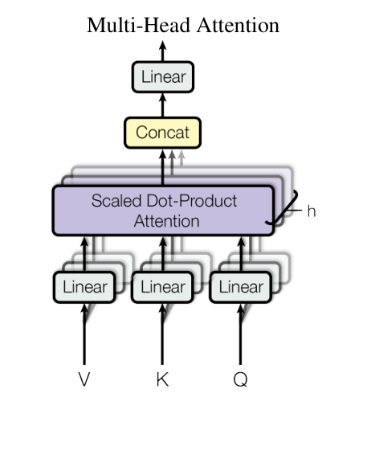
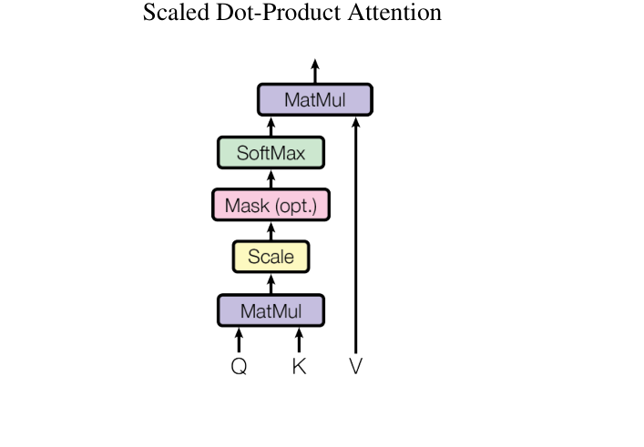

# Page 3 of 15 - Attention Is All You Need

> Page 3 of the source PDF, verbatim as extracted. Canonical document: [01 - Attention Is All You Need](../../papers/01-attention-is-all-you-need.md)

Scaled Dot-Product Attention

Multi-Head Attention

Figure 2: (left) Scaled Dot-Product Attention. (right) Multi-Head Attention consists of several attention layers running in parallel.

of the values, where the weight assigned to each value is computed by a compatibility function of the query with the corresponding key.

3.2.1 Scaled Dot-Product Attention

We call our particular attention "Scaled Dot-Product Attention" (Figure 2). The input consists of queries and keys of dimension dk, and values of dimension dv. We compute the dot products of the query with all keys, divide each by √dk, and apply a softmax function to obtain the weights on the values.

In practice, we compute the attention function on a set of queries simultaneously, packed together into a matrix Q. The keys and values are also packed together into matrices K and V . We compute the matrix of outputs as:

Attention(Q, K, V ) = softmax(QKT

√dk

)V (1)

The two most commonly used attention functions are additive attention \[2\], and dot-product (multiplicative) attention. Dot-product attention is identical to our algorithm, except for the scaling factor of 1 √dk . Additive attention computes the compatibility function using a feed-forward network with a single hidden layer. While the two are similar in theoretical complexity, dot-product attention is much faster and more space-efficient in practice, since it can be implemented using highly optimized matrix multiplication code.

While for small values of dk the two mechanisms perform similarly, additive attention outperforms dot product attention without scaling for larger values of dk \[3\]. We suspect that for large values of dk, the dot products grow large in magnitude, pushing the softmax function into regions where it has extremely small gradients 4. To counteract this effect, we scale the dot products by 1 √dk .

3.2.2 Multi-Head Attention

Instead of performing a single attention function with dmodel-dimensional keys, values and queries, we found it beneficial to linearly project the queries, keys and values h times with different, learned linear projections to dk, dk and dv dimensions, respectively. On each of these projected versions of queries, keys and values we then perform the attention function in parallel, yielding dv-dimensional

4To illustrate why the dot products get large, assume that the components of q and k are independent random variables with mean 0 and variance 1. Then their dot product, q · k = Pdk

i=1 qiki, has mean 0 and variance dk.

---

[previous page](page-002.md) · [next page](page-004.md) · [all pages](index.md)
