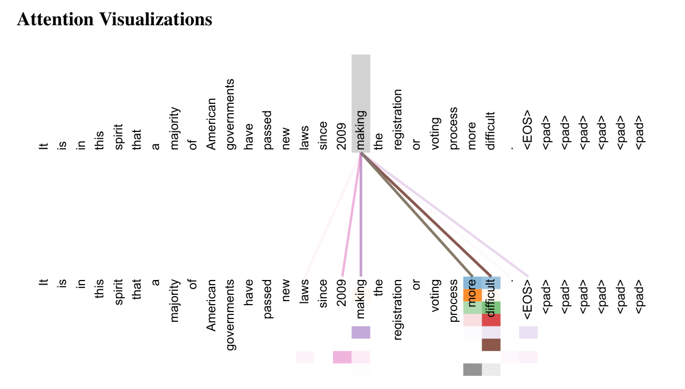

# Page 12 of 15 - Attention Is All You Need

> Page 12 of the source PDF, verbatim as extracted. Canonical document: [01 - Attention Is All You Need](../../papers/01-attention-is-all-you-need.md)

## Attention Visualizations

governments

registration

American

majority

process

<EOS>

passed

making

difficult

<pad>

<pad>

<pad>

<pad>

<pad>

<pad>

voting

since

more

2009

have

spirit

laws

new

that

this

the

or

of

in

is

It

a

.

It

is

in

this

spirit

that

a

majority

of

American

governments

have

passed

new

laws

since

2009

making

the

registration

or

voting

process

more

difficult

.

<EOS>

<pad>

<pad>

<pad>

<pad>

<pad>

<pad>

Figure 3: An example of the attention mechanism following long-distance dependencies in the encoder self-attention in layer 5 of 6. Many of the attention heads attend to a distant dependency of the verb ‘making’, completing the phrase ‘making...more difficult’. Attentions here shown only for the word ‘making’. Different colors represent different heads. Best viewed in color.

---

[previous page](page-011.md) · [next page](page-013.md) · [all pages](index.md)
