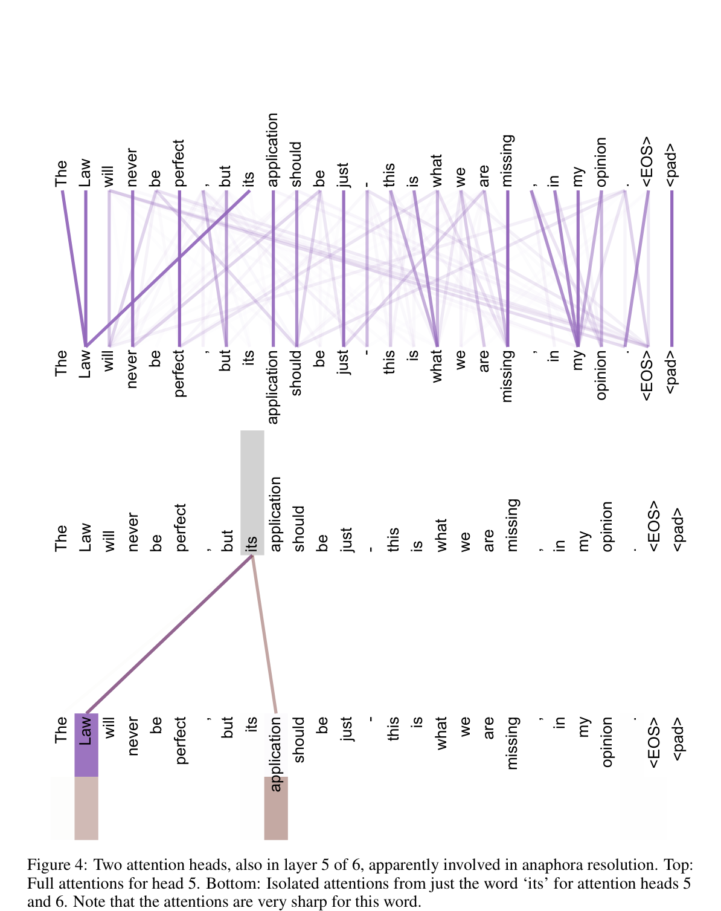

# Page 13 of 15 - Attention Is All You Need

> Page 13 of the source PDF, verbatim as extracted. Canonical document: [01 - Attention Is All You Need](../../papers/01-attention-is-all-you-need.md)

application

missing

<EOS>

opinion

perfect

should

<pad>

never

what

Law

The

just

this

are

will

but

my

we

be

be

its

in

is

-

,

,

.

The

Law

will

never

be

perfect

,

but

its

application

should

be

just

-

this

is

what

we

are

missing

,

in

my

opinion

.

<EOS>

<pad>

application

missing

<EOS>

opinion

perfect

should

<pad>

never

what

Law

The

just

this

are

will

but

my

we

be

be

its

in

is

-

,

,

.

The

Law

will

never

be

perfect

,

but

its

application

should

be

just

-

this

is

what

we

are

missing

,

in

my

opinion

.

<EOS>

<pad>

Figure 4: Two attention heads, also in layer 5 of 6, apparently involved in anaphora resolution. Top: Full attentions for head 5. Bottom: Isolated attentions from just the word ‘its’ for attention heads 5 and 6. Note that the attentions are very sharp for this word.

---

[previous page](page-012.md) · [next page](page-014.md) · [all pages](index.md)
