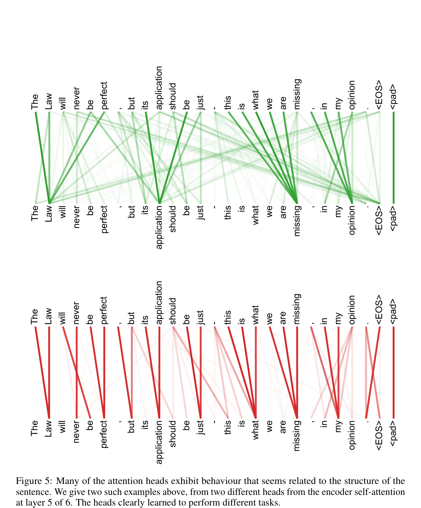

# Page 14 of 15 - Attention Is All You Need

> Page 14 of the source PDF, verbatim as extracted. Canonical document: [01 - Attention Is All You Need](../../papers/01-attention-is-all-you-need.md)

application

missing

<EOS>

opinion

perfect

should

<pad>

never

what

Law

The

just

this

are

will

but

my

we

be

be

its

in

is

-

,

,

.

The

Law

will

never

be

perfect

,

but

its

application

should

be

just

-

this

is

what

we

are

missing

,

in

my

opinion

.

<EOS>

<pad>

application

missing

<EOS>

opinion

perfect

should

<pad>

never

what

Law

The

just

this

are

will

but

my

we

be

be

its

in

is

-

,

,

.

The

Law

will

never

be

perfect

,

but

its

application

should

be

just

-

this

is

what

we

are

missing

,

in

my

opinion

.

<EOS>

<pad>

Figure 5: Many of the attention heads exhibit behaviour that seems related to the structure of the sentence. We give two such examples above, from two different heads from the encoder self-attention at layer 5 of 6. The heads clearly learned to perform different tasks.

---

[previous page](page-013.md) · [next page](page-015.md) · [all pages](index.md)
