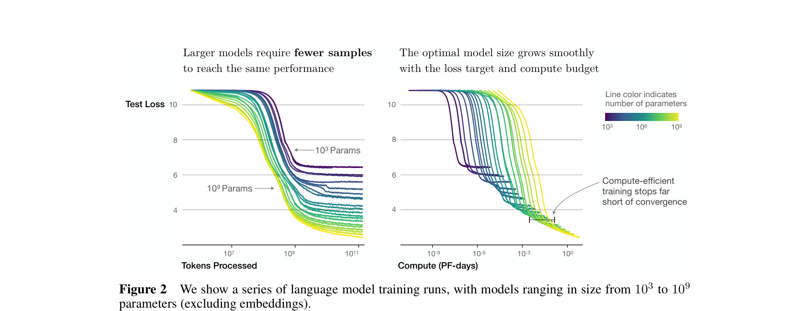

# Page 3 of 30 - Scaling Laws for Neural Language Models

> Page 3 of the source PDF, verbatim as extracted. Canonical document: [03 - Scaling Laws for Neural Language Models](../../papers/03-scaling-laws-for-neural-language-models.md)

Larger models require fewer samples to reach the same performance

The optimal model size grows smoothly with the loss target and compute budget

Line color indicates number of parameters

Test Loss

10

10

103 109 106

8

8

103 Params

6

6

Compute-efficient training stops far short of convergence

109 Params

4

4

107 109 1011

10-9 10-6 10-3 100

Tokens Processed Compute (PF-days)

Figure 2 We show a series of language model training runs, with models ranging in size from 103 to 109 parameters (excluding embeddings).

<10x Serial Steps

Minimum serial steps increases negligibly

Data requirements grow relatively slowly

100x Batch Size

Optimal model size increases very quickly

>1,000,000x Model Size

Figure 3 As more compute becomes available, we can choose how much to allocate towards training larger models, using larger batches, and training for more steps. We illustrate this for a billion-fold increase in compute. For optimally compute-efficient training, most of the increase should go towards increased model size. A relatively small increase in data is needed to avoid reuse. Of the increase in data, most can be used to increase parallelism through larger batch sizes, with only a very small increase in serial training time required.

## 1.2 Summary of Scaling Laws

The test loss of a Transformer trained to autoregressively model language can be predicted using a power-law when performance is limited by only either the number of non-embedding parameters N, the dataset size D, or the optimally allocated compute budget Cmin (see Figure 1):

1. For models with a limited number of parameters, trained to convergence on sufficiently large datasets:

L(N) = (Nc/N)αN ; αN ∼0.076, Nc ∼8.8 × 1013 (non-embedding parameters) (1.1)

2. For large models trained with a limited dataset with early stopping:

L(D) = (Dc/D)αD ; αD ∼0.095, Dc ∼5.4 × 1013 (tokens) (1.2)

3. When training with a limited amount of compute, a sufficiently large dataset, an optimally-sized model, and a sufficiently small batch size (making optimal3 use of compute):

αmin

c ∼3.1 × 108 (PF-days) (1.3)

Cmin

C ; αmin

C ∼0.050, Cmin

L(Cmin) =

c /Cmin

3We also observe an empirical power-law trend with the training compute C (Figure 1) while training at fixed batch size, but it is the trend with Cmin that should be used to make predictions. They are related by equation (5.5).

---

[previous page](page-002.md) · [next page](page-004.md) · [all pages](index.md)
