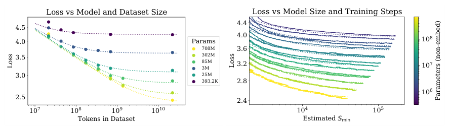

# Page 4 of 30 - Scaling Laws for Neural Language Models

> Page 4 of the source PDF, verbatim as extracted. Canonical document: [03 - Scaling Laws for Neural Language Models](../../papers/03-scaling-laws-for-neural-language-models.md)

Loss vs Model Size and Training Steps

Loss vs Model and Dataset Size

4.4

Parameters (non-embed)

4.5

4.0

108

Params

4.0

3.6

708M 302M 85M 3M 25M 393.2K

3.5

Loss

Loss

3.2

107

3.0

2.8

106

2.5

2.4

104 105

107 108 109 1010

Estimated Smin

Tokens in Dataset

Figure 4 Left: The early-stopped test loss L(N, D) varies predictably with the dataset size D and model size N according to Equation (1.5). Right: After an initial transient period, learning curves for all model sizes N can be fit with Equation (1.6), which is parameterized in terms of Smin, the number of steps when training at large batch size (details in Section 5.1).

These relations hold across eight orders of magnitude in Cmin, six orders of magnitude in N, and over two orders of magnitude in D. They depend very weakly on model shape and other Transformer hyperparameters (depth, width, number of self-attention heads), with specific numerical values associated with the Webtext2 training set \[RWC+19\]. The power laws αN, αD, αmin

C specify the degree of performance improvement expected as we scale up N, D, or Cmin; for example, doubling the number of parameters yields a loss that is smaller by a factor 2−αN = 0.95. The precise numerical values of Nc, Cmin

c , and Dc depend on the vocabulary size and tokenization and hence do not have a fundamental meaning.

The critical batch size, which determines the speed/efficiency tradeoff for data parallelism (\[MKAT18\]), also roughly obeys a power law in L:

Bcrit (L) = B∗ L1/αB , B∗∼2 · 108 tokens, αB ∼0.21 (1.4)

Equation (1.1) and (1.2) together suggest that as we increase the model size, we should increase the dataset size sublinearly according to D ∝N

αN αD ∼N 0.74. In fact, we find that there is a single equation combining (1.1) and (1.2) that governs the simultaneous dependence on N and D and governs the degree of overfitting:

#αD

 αN

"Nc

αD + Dc

L(N, D) =

(1.5)

N

D

with fits pictured on the left in figure 4. We conjecture that this functional form may also parameterize the trained log-likelihood for other generative modeling tasks.

When training a given model for a finite number of parameter update steps S in the infinite data limit, after an initial transient period, the learning curves can be accurately fit by (see the right of figure 4)

αN

αS

Nc

 Sc Smin(S)

L(N, S) =

+

(1.6)

N

where Sc ≈2.1 × 103 and αS ≈0.76, and Smin(S) is the minimum possible number of optimization steps (parameter updates) estimated using Equation (5.4).

When training within a fixed compute budget C, but with no other constraints, Equation (1.6) leads to the prediction that the optimal model size N, optimal batch size B, optimal number of steps S, and dataset size D should grow as

N ∝Cαmin

C /αN , B ∝Cαmin

C /αB, S ∝Cαmin

C /αS, D = B · S (1.7)

with

αmin

C = 1/ (1/αS + 1/αB + 1/αN) (1.8) which closely matches the empirically optimal results N ∝C0.73

min , B ∝C0.24

min , and S ∝C0.03

min . As the computational budget C increases, it should be spent primarily on larger models, without dramatic increases in training time or dataset size (see Figure 3). This also implies that as models grow larger, they become increasingly sample efficient. In practice, researchers typically train smaller models for longer than would

---

[previous page](page-003.md) · [next page](page-005.md) · [all pages](index.md)
