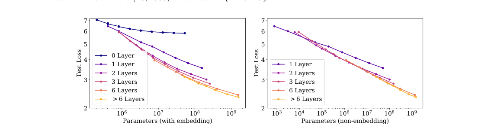

# Page 7 of 30 - Scaling Laws for Neural Language Models

> Page 7 of the source PDF, verbatim as extracted. Canonical document: [03 - Scaling Laws for Neural Language Models](../../papers/03-scaling-laws-for-neural-language-models.md)

10%

8%

Loss Increase

A wide range of architectures

6%

achieve similar performance

22% additional compute compensates for 1% loss increase

4%

2%

0%

Feed-Forward Ratio (dff / dmodel)

50M Parameters Aspect Ratio (dmodel / nlayer) Attention Head Dimension (dmodel / nhead)

25M Parameters

Figure 5 Performance depends very mildly on model shape when the total number of non-embedding parameters N is held fixed. The loss varies only a few percent over a wide range of shapes. Small differences in parameter counts are compensated for by using the fit to L(N) as a baseline. Aspect ratio in particular can vary by a factor of 40 while only slightly impacting performance; an (nlayer, dmodel) = (6, 4288) reaches a loss within 3% of the (48, 1600) model used in \[RWC+19\].

7

7

6

6

5

5

Test Loss

Test Loss

0 Layer 1 Layer 2 Layers 3 Layers 6 Layers > 6 Layers

4

4

1 Layer 2 Layers 3 Layers 6 Layers > 6 Layers

3

3

2

2

106 107 108 109

103 104 105 106 107 108 109

Parameters (with embedding)

Parameters (non-embedding)

Figure 6 Left: When we include embedding parameters, performance appears to depend strongly on the number of layers in addition to the number of parameters. Right: When we exclude embedding parameters, the performance of models with different depths converge to a single trend. Only models with fewer than 2 layers or with extreme depth-to-width ratios deviate significantly from the trend.

In this section we will display data along with empirically-motivated fits, deferring theoretical analysis to later sections.

## 3.1 Approximate Transformer Shape and Hyperparameter Independence

Transformer performance depends very weakly on the shape parameters nlayer, nheads, and dffwhen we hold the total non-embedding parameter count N fixed. To establish these results we trained models with fixed size while varying a single hyperparameter. This was simplest for the case of nheads. When varying nlayer, we simultaneously varied dmodel while keeping N ≈12nlayerd2

model fixed. Similarly, to vary dffat fixed model size we also simultaneously varied the dmodel parameter, as required by the parameter counts in Table 1. Independence of nlayers would follow if deeper Transformers effectively behave as ensembles of shallower models, as has been suggested for ResNets \[VWB16\]. The results are shown in Figure 5.

3.2 Performance with Non-Embedding Parameter Count N

In Figure 6 we display the performance of a wide variety of models, ranging from small models with shape (nlayer, dmodel) = (2, 128) through billion-parameter models, ranging in shape from (6, 4288) through (207, 768). Here we have trained to near convergence on the full WebText2 dataset and observe no overfitting (except possibly for the very largest models).

As shown in Figure 1, we find a steady trend with non-embedding parameter count N, which can be fit to the first term of Equation (1.5), so that

αN

Nc

L(N) ≈

(3.1)

N

---

[previous page](page-006.md) · [next page](page-008.md) · [all pages](index.md)
