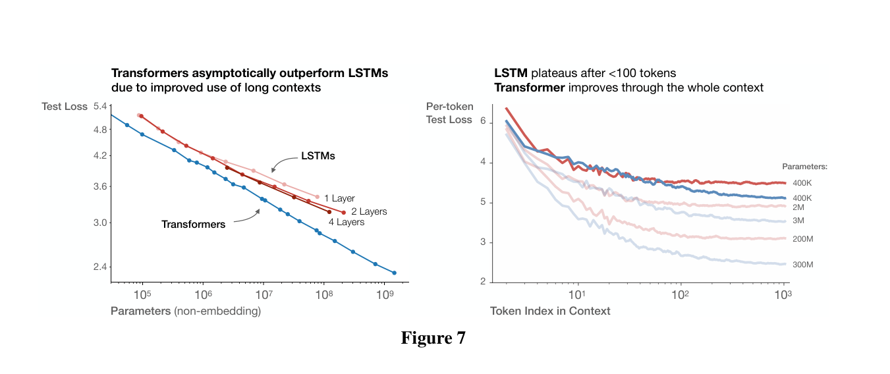

# Page 8 of 30 - Scaling Laws for Neural Language Models

> Page 8 of the source PDF, verbatim as extracted. Canonical document: [03 - Scaling Laws for Neural Language Models](../../papers/03-scaling-laws-for-neural-language-models.md)

Transformers asymptotically outperform LSTMs due to improved use of long contexts

LSTM plateaus after <100 tokens Transformer improves through the whole context

Test Loss Per-token Test Loss

5.4

6

4.8

LSTMs

4.2

4

Parameters:

400K

3.6

1 Layer 2 Layers 4 Layers

400K

5

2M

3M

3.0

Transformers

200M

3

300M

2.4

2

105 108 106 107 109

103 102 101

Parameters (non-embedding)

Token Index in Context

Figure 7

To observe these trends it is crucial to study performance as a function of N; if we instead use the total parameter count (including the embedding parameters) the trend is somewhat obscured (see Figure 6). This suggests that the embedding matrix can be made smaller without impacting performance, as has been seen in recent work \[LCG+19\].

Although these models have been trained on the WebText2 dataset, their test loss on a variety of other datasets is also a power-law in N with nearly identical power, as shown in Figure 8.

## 3.2.1 Comparing to LSTMs and Universal Transformers

In Figure 7 we compare LSTM and Transformer performance as a function of non-embedding parameter count N. The LSTMs were trained with the same dataset and context length. We see from these figures that the LSTMs perform as well as Transformers for tokens appearing early in the context, but cannot match the Transformer performance for later tokens. We present power-law relationships between performance and context position Appendix D.5, where increasingly large powers for larger models suggest improved ability to quickly recognize patterns.

We also compare the performance of standard Transformers to recurrent Transformers \[DGV+18\] in Figure 17 in the appendix. These models re-use parameters, and so perform slightly better as a function of N, at the cost of additional compute per-parameter.

## 3.2.2 Generalization Among Data Distributions

We have also tested our models on a set of additional text data distributions. The test loss on these datasets as a function of model size is shown in Figure 8; in all cases the models were trained only on the WebText2 dataset. We see that the loss on these other data distributions improves smoothly with model size, in direct parallel with the improvement on WebText2. We find that generalization depends almost exclusively on the in-distribution validation loss, and does not depend on the duration of training or proximity to convergence. We also observe no dependence on model depth (see Appendix D.8).

## 3.3 Performance with Dataset Size and Compute

We display empirical trends for the test loss as a function of dataset size D (in tokens) and training compute C in Figure 1.

For the trend with D we trained a model with (nlayer, nembd) = (36, 1280) on fixed subsets of the WebText2 dataset. We stopped training once the test loss ceased to decrease. We see that the resulting test losses can be fit with simple power-law

αD

Dc

L(D) ≈

(3.2)

D

in the dataset size. The data and fit appear in Figure 1.

The total amount of non-embedding compute used during training can be estimated as C = 6NBS, where B is the batch size, S is the number of parameter updates, and the factor of 6 accounts for the forward and backward passes. Thus for a given value of C we can scan over all models with various N to find the model

---

[previous page](page-007.md) · [next page](page-009.md) · [all pages](index.md)
