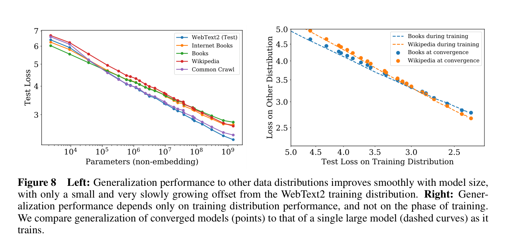

# Page 9 of 30 - Scaling Laws for Neural Language Models

> Page 9 of the source PDF, verbatim as extracted. Canonical document: [03 - Scaling Laws for Neural Language Models](../../papers/03-scaling-laws-for-neural-language-models.md)

5.0

7

Books during training Wikipedia during training Books at convergence Wikipedia at convergence

WebText2 (Test) Internet Books Books Wikipedia Common Crawl

Loss on Other Distribution

4.5

6

4.0

5

Test Loss

3.5

4

3.0

3

2.5

104 105 106 107 108 109

2.5 3.0 3.5 4.0 4.5 5.0 Test Loss on Training Distribution

Parameters (non-embedding)

Figure 8 Left: Generalization performance to other data distributions improves smoothly with model size, with only a small and very slowly growing offset from the WebText2 training distribution. Right: Generalization performance depends only on training distribution performance, and not on the phase of training. We compare generalization of converged models (points) to that of a single large model (dashed curves) as it trains.

with the best performance on step S = C 6BS . Note that in these results the batch size B remains fixed for all models, which means that these empirical results are not truly optimal. We will account for this in later sections using an adjusted Cmin to produce cleaner trends.

The result appears as the heavy black line on the left-hand plot in Figure 1. It can be fit with

αC

Cc

L(C) ≈

(3.3)

C

The figure also includes images of individual learning curves to clarify when individual models are optimal. We will study the optimal allocation of compute more closely later on. The data strongly suggests that sample efficiency improves with model size, and we also illustrate this directly in Figure 19 in the appendix.

## 4 Charting the Infinite Data Limit and Overfitting

In Section 3 we found a number of basic scaling laws for language modeling performance. Here we will study the performance of a model of size N trained on a dataset with D tokens while varying N and D simultaneously. We will empirically demonstrate that the optimally trained test loss accords with the scaling law of Equation (1.5). This provides guidance on how much data we would need to train models of increasing size while keeping overfitting under control.

4.1 Proposed L(N, D) Equation

We have chosen the parameterization (1.5) (repeated here for convenience):

#αD

 αN

"Nc

αD + Dc

L(N, D) =

(4.1)

N

D

using three principles:

1. Changes in vocabulary size or tokenization are expected to rescale the loss by an overall factor. The parameterization of L(N, D) (and all models of the loss) must naturally allow for such a rescaling.

2. Fixing D and sending N →∞, the overall loss should approach L(D). Conversely, fixing N and sending D →∞the loss must approach L(N).

3. L(N, D) should be analytic at D = ∞, so that it has a series expansion in 1/D with integer powers. Theoretical support for this principle is significantly weaker than for the first two.

Our choice of L(N, D) satisfies the first requirement because we can rescale Nc, Dc with changes in the vocabulary. This also implies that the values of Nc, Dc have no fundamental meaning.

---

[previous page](page-008.md) · [next page](page-010.md) · [all pages](index.md)
