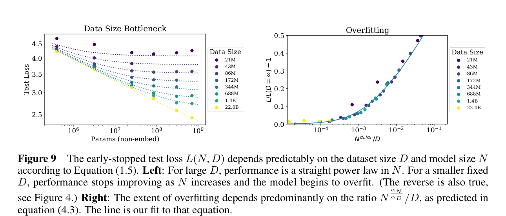

# Page 10 of 30 - Scaling Laws for Neural Language Models

> Page 10 of the source PDF, verbatim as extracted. Canonical document: [03 - Scaling Laws for Neural Language Models](../../papers/03-scaling-laws-for-neural-language-models.md)

Data Size Bottleneck

Overfitting

0.5

4.5

Data Size

Data Size

0.4

4.0

21M 43M 86M 172M 344M 688M 1.4B 22.0B

21M 43M 86M 172M 344M 688M 1.4B 22.0B

L/L(D = ) 1

Test Loss

0.3

3.5

0.2

3.0

0.1

2.5

0.0

10 4 10 3 10 2 10 1

106 107 108 109

N N/ D/D

Params (non-embed)

Figure 9 The early-stopped test loss L(N, D) depends predictably on the dataset size D and model size N according to Equation (1.5). Left: For large D, performance is a straight power law in N. For a smaller fixed D, performance stops improving as N increases and the model begins to overfit. (The reverse is also true, see Figure 4.) Right: The extent of overfitting depends predominantly on the ratio N

αN αD /D, as predicted in equation (4.3). The line is our fit to that equation.

Since we stop training early when the test loss ceases to improve and optimize all models in the same way, we expect that larger models should always perform better than smaller models. But with fixed finite D, we also do not expect any model to be capable of approaching the best possible loss (ie the entropy of text). Similarly, a model with fixed size will be capacity-limited. These considerations motivate our second principle. Note that knowledge of L(N) at infinite D and L(D) at infinite N fully determines all the parameters in L(N, D).

The third principle is more speculative. There is a simple and general reason one might expect overfitting to scale ∝1/D at very large D. Overfitting should be related to the variance or the signal-to-noise ratio of the dataset \[AS17\], and this scales as 1/D. This expectation should hold for any smooth loss function, since we expect to be able to expand the loss about the D →∞limit. However, this argument assumes that 1/D corrections dominate over other sources of variance, such as the finite batch size and other limits on the efficacy of optimization. Without empirical confirmation, we would not be very confident of its applicability.

Our third principle explains the asymmetry between the roles of N and D in Equation (1.5). Very similar symmetric expressions4 are possible, but they would not have a 1/D expansion with integer powers, and would require the introduction of an additional parameter.

In any case, we will see that our equation for L(N, D) fits the data well, which is the most important justification for our L(N, D) ansatz.

## 4.2 Results

We regularize all our models with 10% dropout, and by tracking test loss and stopping once it is no longer decreasing. The results are displayed in Figure 9, including a fit to the four parameters αN, αD, Nc, Dc in Equation (1.5):

Parameter αN αD Nc Dc

Value 0.076 0.103 6.4 × 1013 1.8 × 1013

Table 2 Fits to L(N, D)

We obtain an excellent fit, with the exception of the runs where the dataset has been reduced by a factor of 1024, to about 2 × 107 tokens. With such a small dataset, an epoch consists of only 40 parameter updates. Perhaps such a tiny dataset represents a different regime for language modeling, as overfitting happens very early in training (see Figure 16). Also note that the parameters differ very slightly from those obtained in Section 3, as here we are fitting the full L(N, D) rather than just L(N, ∞) or L(∞, D).

To chart the borderlands of the infinite data limit, we can directly study the extent of overfitting. For all but the largest models, we see no sign of overfitting when training with the full 22B token WebText2 dataset, so we can take it as representative of D = ∞. Thus we can compare finite D to the infinite data limit by

4For example, one might have used L(N, D) =  Nc

 Dc

αN +

αDβ, but this does not have a 1/D expansion.

N

D

---

[previous page](page-009.md) · [next page](page-011.md) · [all pages](index.md)
