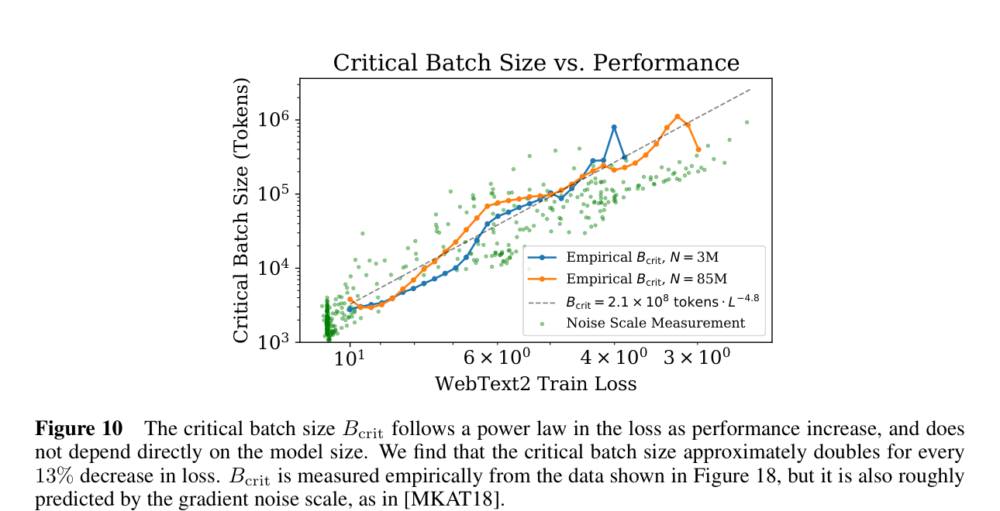

# Page 11 of 30 - Scaling Laws for Neural Language Models

> Page 11 of the source PDF, verbatim as extracted. Canonical document: [03 - Scaling Laws for Neural Language Models](../../papers/03-scaling-laws-for-neural-language-models.md)

Critical Batch Size vs. Performance

Critical Batch Size (Tokens)

106

105

Empirical Bcrit, N = 3M

104

Empirical Bcrit, N = 85M

Bcrit = 2.1 × 108 tokens L 4.8

Noise Scale Measurement

103

101 3 × 100 4 × 100 6 × 100

WebText2 Train Loss

Figure 10 The critical batch size Bcrit follows a power law in the loss as performance increase, and does not depend directly on the model size. We find that the critical batch size approximately doubles for every 13% decrease in loss. Bcrit is measured empirically from the data shown in Figure 18, but it is also roughly predicted by the gradient noise scale, as in \[MKAT18\].

defining

δL(N, D) ≡L(N, D)

L(N, ∞) −1 (4.2)

and studying it as a function of N, D. In fact, we see empirically that δL depends only a specific combination of N and D, as shown in Figure 16. This follows from the scaling law of Equation (1.5), which implies

1 +  N

!αD

 αN

αD Dc

δL ≈

−1 (4.3)

Nc

D

Note that at large D this formula also has a series expansion in powers of 1/D.

We estimate that the variation in the loss with different random seeds is roughly 0.02, which means that to avoid overfitting when training to within that threshold of convergence we require

D ≳(5 × 103) N 0.74 (4.4)

With this relation, models smaller than 109 parameters can be trained with minimal overfitting on the 22B token WebText2 dataset, but our largest models will encounter some mild overfitting. More generally, this relation shows that dataset size may grow sub-linearly in model size while avoiding overfitting. Note however that this does not typically represent maximally compute-efficient training. We should also emphasize that we have not optimized regularization (eg the dropout probability) while varying dataset and model size.

## 5 Scaling Laws with Model Size and Training Time

In this section we will demonstrate that a simple scaling law provides a good description for the loss as a function of model size N and training time. First we will explain how to use the results of \[MKAT18\] to define a universal training step Smin, which accounts for the fact that most of our models have not been trained at an optimal batch size. Then we will demonstrate that we can fit the model size and training time dependence of the loss using Equation (1.6). Later we will use these results to predict the optimal allocation of training compute between model size and training time, and then confirm that prediction.

5.1 Adjustment for Training at Bcrit(L)

A simple empirical theory for the batch size dependence of training was developed in \[MKAT18\] (see also \[SLA+18, ZLN+19\]). It was argued that there is a critical batch size Bcrit for training; for B up to Bcrit the batch size can be increased with very minimal degradation in compute-efficiency, whereas for B > Bcrit increases in B result in diminishing returns. It was also argued that the gradient noise scale provides a simple

---

[previous page](page-010.md) · [next page](page-012.md) · [all pages](index.md)
