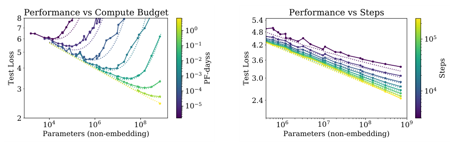

# Page 13 of 30 - Scaling Laws for Neural Language Models

> Page 13 of the source PDF, verbatim as extracted. Canonical document: [03 - Scaling Laws for Neural Language Models](../../papers/03-scaling-laws-for-neural-language-models.md)

Performance vs Compute Budget

Performance vs Steps

7 8

5.4

100

4.8

105

6

4.2

10 1

5

Test Loss

Test Loss

PF-dayss

10 2

3.6

Steps

4

10 3

3.0

3

10 4

104

2.4

10 5

2

106 107 108 109

104 106 108

Parameters (non-embedding)

Parameters (non-embedding)

Figure 11 When we hold either total compute or number of training steps fixed, performance follows L(N, S) from Equation (5.6). Each value of compute budget has an associated optimal model size that maximizes performance. Mediocre fits at small S are unsurprising, as the power-law equation for the learning curves breaks down very early in training.

Parameter αN αS Nc Sc

Value 0.077 0.76 6.5 × 1013 2.1 × 103

Table 3 Fits to L(N, S)

With these parameters, we obtain the learning curve fits in Figure 4. Though the fits are imperfect, we believe they are quite compelling given the simplicity of Equation (5.6).

The data and fits can be visualized in a different and more interesting way, as shown in Figure 11. There we study the test loss as a function of model size while fixing either the total non-embedding compute C used in training, or the number of steps S. For the fits we use Equation (5.5) and (5.4) along with the parameters above and Equation (5.6).

The power-law dependence of the loss on Smin reflects the interplay of optimizer dynamics and the loss landscape. Since the fits are best late in training, when the loss may be approximately quadratic, the powerlaw should provide information about the spectrum of the Hessian of the loss. Its universality suggests that the Hessian eigenvalue density is roughly independent of model size.

## 5.3 Lower Bound on Early Stopping Step

The results for L(N, Smin) can be used to derive a lower-bound (and rough estimate) of the step at which early stopping should occur when training is data limited. It is motivated by the idea that finite and infinite D learning curves for a given model will be very similar until we reach Smin ≈Sstop. Thus overfitting should be proportional to the correction from simply ending training at Sstop. This will underestimate Sstop, because in reality the test loss will decrease more slowly when we have a finite D, and therefore we will require more training steps to reach the optimal test loss at finite D. This line of reasoning leads to the inequality

Sstop(N, D) ≳ Sc \[L(N, D) −L(N, ∞)\]1/αS (5.7)

where L(N, ∞) is the converged loss, evaluated with infinite available data. This inequality and its comparison to the empirical data is displayed in Figure 16 in the appendix. In that figure, the values of Sstop and L(N, D) are empirical (though Sstop is adjusted to mimic training at B ≫Bcrit), while L(N, ∞) is computed from the fit to L(N, D) evaluated at D = ∞.

## 6 Optimal Allocation of the Compute Budget

We displayed the empirical trend of performance as a function of the computation used during training in the top-right of Figure 1. However, this result involved training at a fixed batch size B, whereas we know

---

[previous page](page-012.md) · [next page](page-014.md) · [all pages](index.md)
