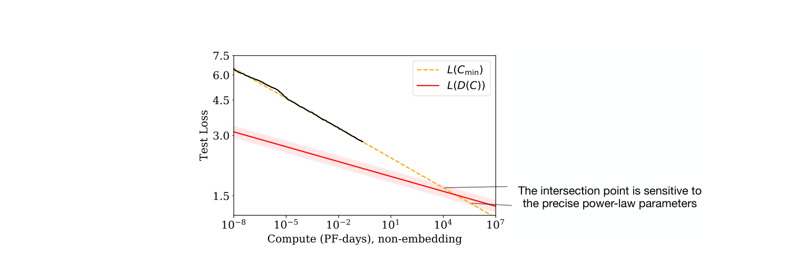

# Page 16 of 30 - Scaling Laws for Neural Language Models

> Page 16 of the source PDF, verbatim as extracted. Canonical document: [03 - Scaling Laws for Neural Language Models](../../papers/03-scaling-laws-for-neural-language-models.md)

The intersection point is sensitive to

the precise power-law parameters

Figure 15 Far beyond the model sizes we study empirically, we find a contradiction between our equations for L(Cmin) and L(D) due to the slow growth of data needed for compute-efficient training. The intersection marks the point before which we expect our predictions to break down. The location of this point is highly sensitive to the precise exponents from our power-law fits.

## 6.3 Contradictions and a Conjecture

We observe no signs of deviation from straight power-law trends at large values of compute, data, or model size. Our trends must eventually level off, though, since natural language has non-zero entropy.

Indeed, the trends for compute-efficient training described in this section already contain an apparent contradiction. At scales several orders of magnitude above those documented here, the performance predicted by the L(Cmin) scaling law decreases below what should be possible given the slow growth in training data with compute. This implies that our scaling laws must break down before this point, but we conjecture that the intersection point has a deeper meaning: it provides an estimate of the point at which Transformer language models reach maximal performance.

Since the amount of data used by compute-efficient training grows slowly with the compute budget, the performance predicted by L(Cmin) eventually hits a lower bound set by the L(D) power law (see Figure 15). Let us work this out in more detail.

To keep overfitting under control, the results of Section 4 imply that we should scale the dataset size as

D ∝N 0.74 ∝C0.54

min (6.6)

where we have used the compute-efficient N(Cmin) from Figure 14.

Let us compare this to the data requirements of compute-efficient training. If we train at the critical batch size (i.e. C = 2Cmin) and never re-use data during training, we find that data usage grows with compute as

D(Cmin) = 2Cmin 6N(Cmin) ≈ 

4 × 1010 tokens 

(Cmin/PF-Day)0.26 (6.7)

This is the maximum rate at which the dataset size can productively grow with compute, since it means that we are only training for a single epoch. But it grows the dataset much more slowly than in Equation (6.6). It appears to imply that compute-efficient training will eventually run into a problem with overfitting, even if the training process never re-uses any data!

According to Figure 1, we expect that when we are bottlenecked by the dataset size (ie by overfitting), the loss should scale as L(D) ∝D−0.095. This implies that the loss would scale with compute as L(D(Cmin)) ∝ C−0.03

min once we are data-limited. Once again, we have a contradiction, as this will eventually intersect with our prediction for L(Cmin) from Figure 13, where we found a scaling L(Cmin) ∝C−0.050

min .

The intersection point of L(D(Cmin)) and L(Cmin) occurs at

C∗∼104 PF-Days N ∗∼1012 parameters, D∗∼1012 tokens, L∗∼1.7 nats/token (6.8)

though the numerical values are highly uncertain, varying by an order or magnitude in either direction depending on the precise values of the exponents from the power-law fits. The most obvious interpretation is that our scaling laws break down at or before we reach this point, which is still many orders of magnitude away in both compute and model size.

---

[previous page](page-015.md) · [next page](page-017.md) · [all pages](index.md)
