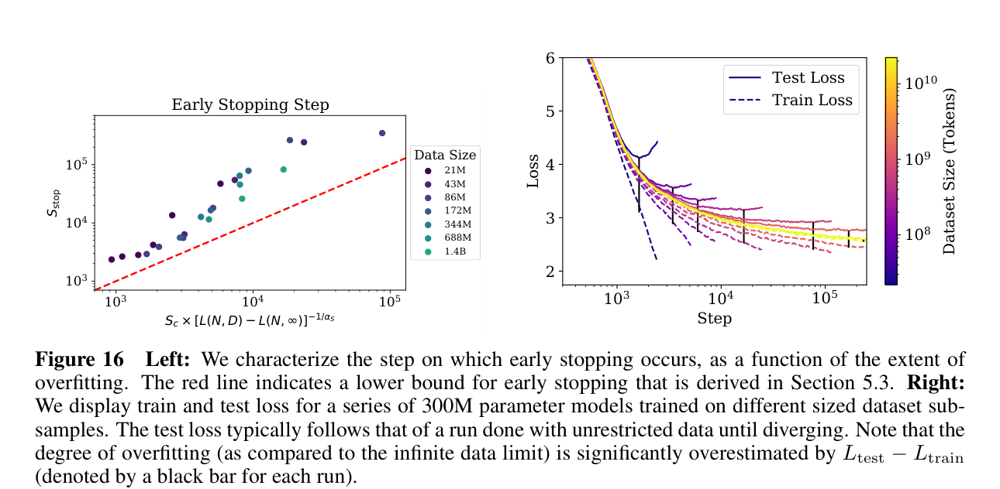

# Page 22 of 30 - Scaling Laws for Neural Language Models

> Page 22 of the source PDF, verbatim as extracted. Canonical document: [03 - Scaling Laws for Neural Language Models](../../papers/03-scaling-laws-for-neural-language-models.md)

6

Test Loss Train Loss

1010

Dataset Size (Tokens)

Early Stopping Step

5

Data Size

109

4

Loss

105

21M 43M 86M 172M 344M 688M 1.4B

Sstop

3

104

108

2

103

103 104 105

103 104 105

Step

Sc × \[L(N, D) L(N, )\] 1/ S

Figure 16 Left: We characterize the step on which early stopping occurs, as a function of the extent of overfitting. The red line indicates a lower bound for early stopping that is derived in Section 5.3. Right: We display train and test loss for a series of 300M parameter models trained on different sized dataset subsamples. The test loss typically follows that of a run done with unrestricted data until diverging. Note that the degree of overfitting (as compared to the infinite data limit) is significantly overestimated by Ltest −Ltrain (denoted by a black bar for each run).

• We are not especially confident in the prediction of Bcrit(L) for values of the loss far outside the range we have explored. Changes in Bcrit could have a significant impact on trade-offs between data parallelism and the number of serial training steps required, which would have a major impact on training time. • We did not thoroughly investigate the small data regime, and our fits for L(N, D) were poor for the smallest values of D (where an epoch corresponded to only 40 steps). Furthermore, we did not experiment with regularization and data augmentation. Improvements in these could alter our results, quantitatively or qualitatively. • We used the estimated training compute C ≈6NBS, which did not include contributions proportional to nctx (see Section 2.1). So our scalings with compute may be confounded in practice in the regime of very large nctx, specifically where nctx ≳12dmodel. • We tuned learning rates, and we experimented with learning rate schedules. But we may have neglected to tune some hyperparameter (e.g. intialization scale or momentum) that have an important effect on scaling. • The optimal choice of learning rate is sensitive to the target loss. When training close to convergence, it may be necessary to use a smaller learning rate to avoid divergences. But when conducting a short training run (eg due to compute limitations), it may be possible to use a larger learning rate. We did not experiment with higher learning rates for training runs that did not proceed to convergence.

## D Supplemental Figures

## D.1 Early Stopping and Test vs Train

In section 5.3 we described the result shown in Figure 16, which provides a prediction for a lower bound on the early stopping step. We also show the train and test loss for a given model size when training on different sized datasets.

## D.2 Universal Transformers

We compare the performance of standard Transformers to recurrent Transformers \[DGV+18\] in Figure 17. These models re-use parameters, and so perform slightly better as a function of N, but slightly worse as a function of compute C. We include several different different possibilities for parameter re-use.

## D.3 Batch Size

We measure the critical batch size using the data displayed in figure 18. This made it possible to estimate Bcrit(L) in figure 10.

---

[previous page](page-021.md) · [next page](page-023.md) · [all pages](index.md)
