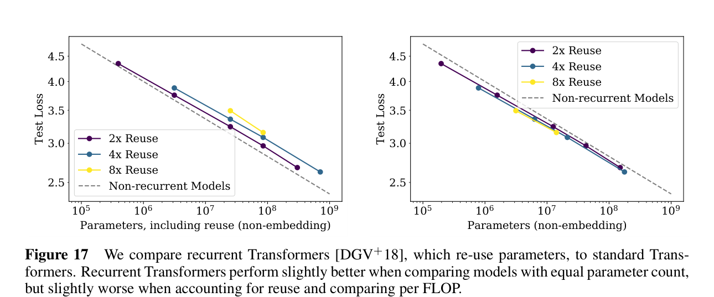
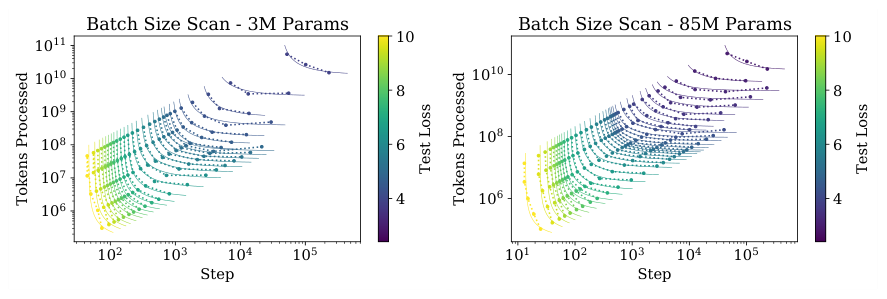
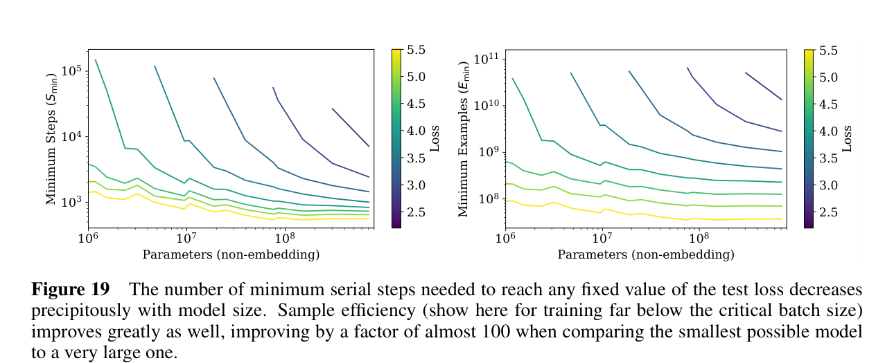

# Page 23 of 30 - Scaling Laws for Neural Language Models

> Page 23 of the source PDF, verbatim as extracted. Canonical document: [03 - Scaling Laws for Neural Language Models](../../papers/03-scaling-laws-for-neural-language-models.md)

2x Reuse 4x Reuse 8x Reuse Non-recurrent Models

4.5

4.5

4.0

4.0

Test Loss

Test Loss

3.5

3.5

2x Reuse 4x Reuse 8x Reuse Non-recurrent Models

3.0

3.0

2.5

2.5

105 106 107 108 109

105 106 107 108 109

Parameters, including reuse (non-embedding)

Parameters (non-embedding)

Figure 17 We compare recurrent Transformers \[DGV+18\], which re-use parameters, to standard Transformers. Recurrent Transformers perform slightly better when comparing models with equal parameter count, but slightly worse when accounting for reuse and comparing per FLOP.

Batch Size Scan - 3M Params

Batch Size Scan - 85M Params

10

10

1011

1010

1010

Tokens Processed

Tokens Processed

8

8

109

Test Loss

Test Loss

108

108

6

6

107

106

4

4

106

102 103 104 105

101 102 103 104 105

Step

Step

Figure 18 These figures demonstrate fits to Equation (5.1) for a large number of values of the loss L, and for two different Transformer model sizes. These fits were used to measure Bcrit(L) for Figure 10.

## D.4 Sample Efficiency vs Model Size

It is easy to see from figure 2 that larger models train faster, and are therefore more sample efficient. We provide another way of looking at this phenomenon in figure 19, which shows when different models reach various fixed values of the loss.

5.5

5.5

1011

Minimum Examples (Emin)

105

5.0

5.0

Minimum Steps (Smin)

4.5

4.5

1010

4.0

4.0

Loss

Loss

104

109

3.5

3.5

3.0

3.0

108

103

2.5

2.5

106 107 108

106 107 108

Parameters (non-embedding)

Parameters (non-embedding)

Figure 19 The number of minimum serial steps needed to reach any fixed value of the test loss decreases precipitously with model size. Sample efficiency (show here for training far below the critical batch size) improves greatly as well, improving by a factor of almost 100 when comparing the smallest possible model to a very large one.

---

[previous page](page-022.md) · [next page](page-024.md) · [all pages](index.md)
