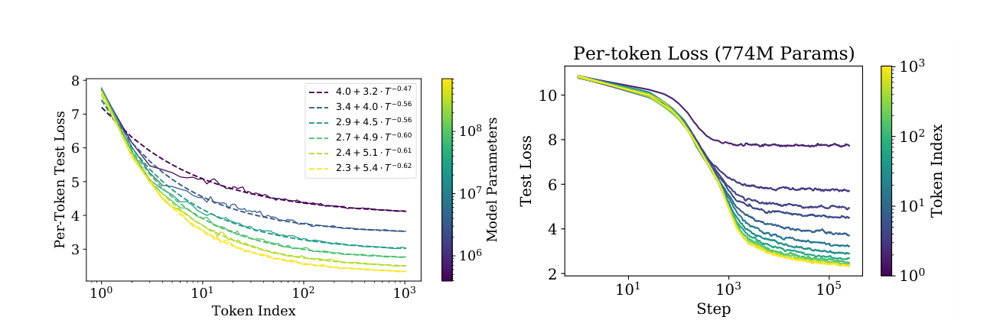
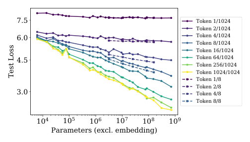

# Page 24 of 30 - Scaling Laws for Neural Language Models

> Page 24 of the source PDF, verbatim as extracted. Canonical document: [03 - Scaling Laws for Neural Language Models](../../papers/03-scaling-laws-for-neural-language-models.md)

Per-token Loss (774M Params)

103

8

4.0 + 3.2 T 0.47

10

3.4 + 4.0 T 0.56

7

Per-Token Test Loss

2.9 + 4.5 T 0.56

Model Parameters

108

Token Index

102

2.7 + 4.9 T 0.60

8

Test Loss

6

2.4 + 5.1 T 0.61

2.3 + 5.4 T 0.62

5

6

107

101

4

4

3

106

2

100

101 103 105

100 101 102 103

Step

Token Index

Figure 20 This figure provides information about the performance per token as a function of model size and training time. Left: Loss per token as a function of its position T in the 1024-token context. Loss scales predictably as a power-law in T. Right: Test loss per token as a function of training step.

7.5

Token 1/1024 Token 2/1024 Token 4/1024 Token 8/1024 Token 16/1024 Token 64/1024 Token 256/1024 Token 1024/1024 Token 1/8 Token 2/8 Token 4/8 Token 8/8

6.0

Test Loss

4.5

3.0

104 105 106 107 108 109

Parameters (excl. embedding)

Figure 21 In addition to the averaged loss, individual tokens within the 1024-token context also improve smoothly as model size increases. Training runs with shorter context nctx = 8 (dashed lines) perform better on early tokens, since they can allocate all of their capacity to them.

## D.5 Context Dependence

The trends for loss as a function of model size are displayed for different tokens in the context in Figure 21. We see that models trained on nctx = 1024 show steady improvement with model size on all but the first token.

Fixing model size, it appears that the loss scales as a power-law as a function of position T in the context, see Figure 20. This may be a consequence of underlying power-law correlations in language \[EP94, ACDE12, LT16\], or a more general feature of the model architecture and optimization. It provides some suggestion for the potential benefits (or lack thereof) from training on larger contexts. Not only do larger models converge to better performance at T = 1024, but they also improve more quickly at early tokens, suggesting that larger models are more efficient at detecting patterns with less contextual information. In the right-hand plot we show how per-token performance varies for a fixed model as a function of the training step. The model begins by learning short-range information, and only learns longer-range correlations later in training.

We have also included models trained with a tiny context nctx = 8 in order to compare with our longer context models. Even modestly sized models trained on nctx = 8 can dominate our largest nctx = 1024 models on very early tokens. This also suggests that further improvements should be possible with much larger models trained on large contexts.

## D.6 Learning Rate Schedules and Error Analysis

We experimented with a variety of learning rates and schedules. A host of schedules and resulting test performances for a small language model are plotted in Figure 22. We conclude that the choice of learning rate schedule is mostly irrelevant, as long as the total summed learning rate is sufficiently large, and the schedule includes a warmup period and a final decay to near-vanishing learning rate. Variations among

---

[previous page](page-023.md) · [next page](page-025.md) · [all pages](index.md)
