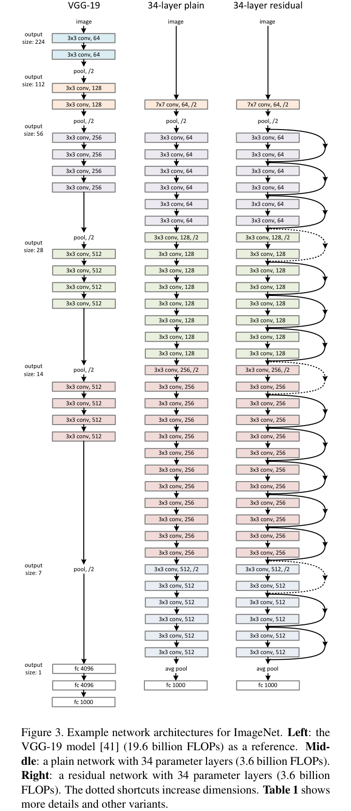

# Page 3 of 12 - Deep Residual Learning for Image Recognition

> Page 3 of the source PDF, verbatim as extracted. Canonical document: [05 - Deep Residual Learning for Image Recognition](../../papers/05-deep-residual-learning-resnet.md)

Residual Network. Based on the above plain network, we insert shortcut connections (Fig. 3, right) which turn the network into its counterpart residual version. The identity shortcuts (Eqn.(1)) can be directly used when the input and output are of the same dimensions (solid line shortcuts in Fig. 3). When the dimensions increase (dotted line shortcuts in Fig. 3), we consider two options: (A) The shortcut still performs identity mapping, with extra zero entries padded for increasing dimensions. This option introduces no extra parameter; (B) The projection shortcut in Eqn.(2) is used to match dimensions (done by 1×1 convolutions). For both options, when the shortcuts go across feature maps of two sizes, they are performed with a stride of 2.

VGG-19 34-layer plain

image 34-layer residual

image

image

output size: 224

3x3 conv, 64

3x3 conv, 64

pool, /2

output size: 112

3x3 conv, 128

3x3 conv, 128

7x7 conv, 64, /2

7x7 conv, 64, /2

pool, /2

pool, /2

pool, /2

output size: 56

3x3 conv, 256

3x3 conv, 64

3x3 conv, 64

3x3 conv, 256

3x3 conv, 64

3x3 conv, 64

3x3 conv, 256

3x3 conv, 64

3x3 conv, 64

3x3 conv, 256

3x3 conv, 64

3x3 conv, 64

3x3 conv, 64

3x3 conv, 64

## 3.4. Implementation

3x3 conv, 64

3x3 conv, 64

Our implementation for ImageNet follows the practice in \[21, 41\]. The image is resized with its shorter side randomly sampled in \[256, 480\] for scale augmentation \[41\]. A 224×224 crop is randomly sampled from an image or its horizontal flip, with the per-pixel mean subtracted \[21\]. The standard color augmentation in \[21\] is used. We adopt batch normalization (BN) \[16\] right after each convolution and before activation, following \[16\]. We initialize the weights as in \[13\] and train all plain/residual nets from scratch. We use SGD with a mini-batch size of 256. The learning rate starts from 0.1 and is divided by 10 when the error plateaus, and the models are trained for up to 60 × 104 iterations. We use a weight decay of 0.0001 and a momentum of 0.9. We do not use dropout \[14\], following the practice in \[16\].

pool, /2

3x3 conv, 128, /2

3x3 conv, 128, /2

output size: 28

3x3 conv, 512

3x3 conv, 128

3x3 conv, 128

3x3 conv, 512

3x3 conv, 128

3x3 conv, 128

3x3 conv, 512

3x3 conv, 128

3x3 conv, 128

3x3 conv, 512

3x3 conv, 128

3x3 conv, 128

3x3 conv, 128

3x3 conv, 128

3x3 conv, 128

3x3 conv, 128

3x3 conv, 128

3x3 conv, 128

output size: 14

pool, /2

3x3 conv, 256, /2

3x3 conv, 256, /2

3x3 conv, 512

3x3 conv, 256

3x3 conv, 256

3x3 conv, 512

3x3 conv, 256

3x3 conv, 256

3x3 conv, 512

3x3 conv, 256

3x3 conv, 256

3x3 conv, 512

3x3 conv, 256

3x3 conv, 256

3x3 conv, 256

3x3 conv, 256

In testing, for comparison studies we adopt the standard 10-crop testing \[21\]. For best results, we adopt the fullyconvolutional form as in \[41, 13\], and average the scores at multiple scales (images are resized such that the shorter side is in {224, 256, 384, 480, 640}).

3x3 conv, 256

3x3 conv, 256

3x3 conv, 256

3x3 conv, 256

3x3 conv, 256

3x3 conv, 256

3x3 conv, 256

3x3 conv, 256

3x3 conv, 256

3x3 conv, 256

## 4. Experiments

3x3 conv, 256

3x3 conv, 256

output

pool, /2

3x3 conv, 512, /2

3x3 conv, 512, /2

## 4.1. ImageNet Classification

size: 7

3x3 conv, 512

3x3 conv, 512

We evaluate our method on the ImageNet 2012 classification dataset \[36\] that consists of 1000 classes. The models are trained on the 1.28 million training images, and evaluated on the 50k validation images. We also obtain a final result on the 100k test images, reported by the test server. We evaluate both top-1 and top-5 error rates.

3x3 conv, 512

3x3 conv, 512

3x3 conv, 512

3x3 conv, 512

3x3 conv, 512

3x3 conv, 512

3x3 conv, 512

3x3 conv, 512

output

fc 4096

avg pool

avg pool

size: 1

fc 4096

fc 1000

fc 1000

Plain Networks. We first evaluate 18-layer and 34-layer plain nets. The 34-layer plain net is in Fig. 3 (middle). The 18-layer plain net is of a similar form. See Table 1 for detailed architectures.

fc 1000

Figure 3. Example network architectures for ImageNet. Left: the VGG-19 model \[41\] (19.6 billion FLOPs) as a reference. Middle: a plain network with 34 parameter layers (3.6 billion FLOPs). Right: a residual network with 34 parameter layers (3.6 billion FLOPs). The dotted shortcuts increase dimensions. Table 1 shows more details and other variants.

The results in Table 2 show that the deeper 34-layer plain net has higher validation error than the shallower 18-layer plain net. To reveal the reasons, in Fig. 4 (left) we compare their training/validation errors during the training procedure. We have observed the degradation problem - the

4

---

[previous page](page-002.md) · [next page](page-004.md) · [all pages](index.md)
