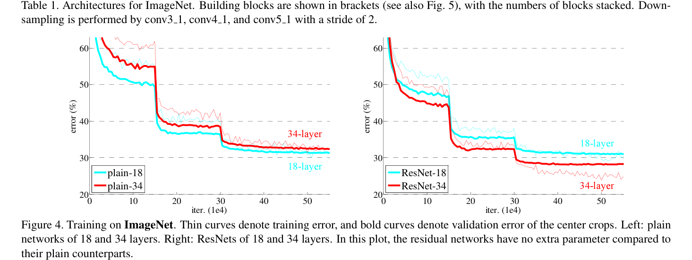

# Page 4 of 12 - Deep Residual Learning for Image Recognition

> Page 4 of the source PDF, verbatim as extracted. Canonical document: [05 - Deep Residual Learning for Image Recognition](../../papers/05-deep-residual-learning-resnet.md)

layer name output size 18-layer 34-layer 50-layer 101-layer 152-layer conv1 112×112 7×7, 64, stride 2

3×3 max pool, stride 2 













1×1, 64 3×3, 64 1×1, 256

1×1, 64 3×3, 64 1×1, 256

1×1, 64 3×3, 64 1×1, 256

conv2 x 56×56

3×3, 64 3×3, 64

3×3, 64 3×3, 64

×2

×3

×3

×3

×3



















1×1, 128 3×3, 128 1×1, 512

1×1, 128 3×3, 128 1×1, 512

1×1, 128 3×3, 128 1×1, 512

conv3 x 28×28 

3×3, 128 3×3, 128

3×3, 128 3×3, 128

×2

×4

×4

×4

×8



















1×1, 256 3×3, 256 1×1, 1024

1×1, 256 3×3, 256 1×1, 1024

1×1, 256 3×3, 256 1×1, 1024

conv4 x 14×14 

3×3, 256 3×3, 256

3×3, 256 3×3, 256

×2

×6

×6

×23

×36



















1×1, 512 3×3, 512 1×1, 2048

1×1, 512 3×3, 512 1×1, 2048

1×1, 512 3×3, 512 1×1, 2048

conv5 x 7×7 

3×3, 512 3×3, 512

3×3, 512 3×3, 512

×2

×3

×3

×3

×3







1×1 average pool, 1000-d fc, softmax FLOPs 1.8×109 3.6×109 3.8×109 7.6×109 11.3×109

Table 1. Architectures for ImageNet. Building blocks are shown in brackets (see also Fig. 5), with the numbers of blocks stacked. Downsampling is performed by conv3 1, conv4 1, and conv5 1 with a stride of 2.

60

60

50

50

error (%)

error (%)

40

40

34-layer 18-layer

30

30

18-layer

plain-18 plain-34

ResNet-18 ResNet-34

34-layer

0 10 20 30 40 50 20

0 10 20 30 40 50 20

iter. (1e4)

iter. (1e4)

Figure 4. Training on ImageNet. Thin curves denote training error, and bold curves denote validation error of the center crops. Left: plain networks of 18 and 34 layers. Right: ResNets of 18 and 34 layers. In this plot, the residual networks have no extra parameter compared to their plain counterparts.

reducing of the training error3. The reason for such optimization difficulties will be studied in the future.

plain ResNet 18 layers 27.94 27.88 34 layers 28.54 25.03

Residual Networks. Next we evaluate 18-layer and 34layer residual nets (ResNets). The baseline architectures are the same as the above plain nets, expect that a shortcut connection is added to each pair of 3×3 filters as in Fig. 3 (right). In the first comparison (Table 2 and Fig. 4 right), we use identity mapping for all shortcuts and zero-padding for increasing dimensions (option A). So they have no extra parameter compared to the plain counterparts.

Table 2. Top-1 error (%, 10-crop testing) on ImageNet validation. Here the ResNets have no extra parameter compared to their plain counterparts. Fig. 4 shows the training procedures.

34-layer plain net has higher training error throughout the whole training procedure, even though the solution space of the 18-layer plain network is a subspace of that of the 34-layer one.

We have three major observations from Table 2 and Fig. 4. First, the situation is reversed with residual learning – the 34-layer ResNet is better than the 18-layer ResNet (by 2.8%). More importantly, the 34-layer ResNet exhibits considerably lower training error and is generalizable to the validation data. This indicates that the degradation problem is well addressed in this setting and we manage to obtain accuracy gains from increased depth.

We argue that this optimization difficulty is unlikely to be caused by vanishing gradients. These plain networks are trained with BN \[16\], which ensures forward propagated signals to have non-zero variances. We also verify that the backward propagated gradients exhibit healthy norms with BN. So neither forward nor backward signals vanish. In fact, the 34-layer plain net is still able to achieve competitive accuracy (Table 3), suggesting that the solver works to some extent. We conjecture that the deep plain nets may have exponentially low convergence rates, which impact the

Second, compared to its plain counterpart, the 34-layer

3We have experimented with more training iterations (3×) and still observed the degradation problem, suggesting that this problem cannot be feasibly addressed by simply using more iterations.

5

---

[previous page](page-003.md) · [next page](page-005.md) · [all pages](index.md)
