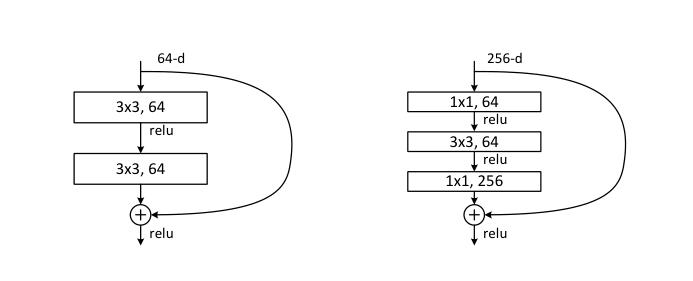

# Page 5 of 12 - Deep Residual Learning for Image Recognition

> Page 5 of the source PDF, verbatim as extracted. Canonical document: [05 - Deep Residual Learning for Image Recognition](../../papers/05-deep-residual-learning-resnet.md)

64-d 256-d

model top-1 err. top-5 err.

VGG-16 \[41\] 28.07 9.33

1x1, 64 relu

3x3, 64

relu

GoogLeNet \[44\] 9.15

3x3, 64

1x1, 256 relu

PReLU-net \[13\] 24.27 7.38

3x3, 64

plain-34 28.54 10.02

relu

relu

ResNet-34 A 25.03 7.76

ResNet-34 B 24.52 7.46

Figure 5. A deeper residual function F for ImageNet. Left: a building block (on 56×56 feature maps) as in Fig. 3 for ResNet34. Right: a “bottleneck” building block for ResNet-50/101/152.

ResNet-34 C 24.19 7.40

ResNet-50 22.85 6.71

ResNet-101 21.75 6.05

ResNet-152 21.43 5.71

parameter-free, identity shortcuts help with training. Next we investigate projection shortcuts (Eqn.(2)). In Table 3 we compare three options: (A) zero-padding shortcuts are used for increasing dimensions, and all shortcuts are parameterfree (the same as Table 2 and Fig. 4 right); (B) projection shortcuts are used for increasing dimensions, and other shortcuts are identity; and (C) all shortcuts are projections.

Table 3. Error rates (%, 10-crop testing) on ImageNet validation. VGG-16 is based on our test. ResNet-50/101/152 are of option B that only uses projections for increasing dimensions.

method top-1 err. top-5 err. VGG \[41\] (ILSVRC’14) 8.43†

GoogLeNet \[44\] (ILSVRC’14) 7.89 VGG \[41\] (v5) 24.4 7.1 PReLU-net \[13\] 21.59 5.71 BN-inception \[16\] 21.99 5.81 ResNet-34 B 21.84 5.71 ResNet-34 C 21.53 5.60 ResNet-50 20.74 5.25 ResNet-101 19.87 4.60 ResNet-152 19.38 4.49

Table 3 shows that all three options are considerably better than the plain counterpart. B is slightly better than A. We argue that this is because the zero-padded dimensions in A indeed have no residual learning. C is marginally better than B, and we attribute this to the extra parameters introduced by many (thirteen) projection shortcuts. But the small differences among A/B/C indicate that projection shortcuts are not essential for addressing the degradation problem. So we do not use option C in the rest of this paper, to reduce memory/time complexity and model sizes. Identity shortcuts are particularly important for not increasing the complexity of the bottleneck architectures that are introduced below.

Table 4. Error rates (%) of single-model results on the ImageNet validation set (except † reported on the test set).

method top-5 err. (test) VGG \[41\] (ILSVRC’14) 7.32 GoogLeNet \[44\] (ILSVRC’14) 6.66 VGG \[41\] (v5) 6.8 PReLU-net \[13\] 4.94 BN-inception \[16\] 4.82 ResNet (ILSVRC’15) 3.57

Deeper Bottleneck Architectures. Next we describe our deeper nets for ImageNet. Because of concerns on the training time that we can afford, we modify the building block as a bottleneck design4. For each residual function F, we use a stack of 3 layers instead of 2 (Fig. 5). The three layers are 1×1, 3×3, and 1×1 convolutions, where the 1×1 layers are responsible for reducing and then increasing (restoring) dimensions, leaving the 3×3 layer a bottleneck with smaller input/output dimensions. Fig. 5 shows an example, where both designs have similar time complexity.

Table 5. Error rates (%) of ensembles. The top-5 error is on the test set of ImageNet and reported by the test server.

The parameter-free identity shortcuts are particularly important for the bottleneck architectures. If the identity shortcut in Fig. 5 (right) is replaced with projection, one can show that the time complexity and model size are doubled, as the shortcut is connected to the two high-dimensional ends. So identity shortcuts lead to more efficient models for the bottleneck designs.

ResNet reduces the top-1 error by 3.5% (Table 2), resulting from the successfully reduced training error (Fig. 4 right vs. left). This comparison verifies the effectiveness of residual learning on extremely deep systems.

Last, we also note that the 18-layer plain/residual nets are comparably accurate (Table 2), but the 18-layer ResNet converges faster (Fig. 4 right vs. left). When the net is “not overly deep” (18 layers here), the current SGD solver is still able to find good solutions to the plain net. In this case, the ResNet eases the optimization by providing faster convergence at the early stage.

50-layer ResNet: We replace each 2-layer block in the

4Deeper non-bottleneck ResNets (e.g., Fig. 5 left) also gain accuracy from increased depth (as shown on CIFAR-10), but are not as economical as the bottleneck ResNets. So the usage of bottleneck designs is mainly due to practical considerations. We further note that the degradation problem of plain nets is also witnessed for the bottleneck designs.

Identity vs. Projection Shortcuts. We have shown that

6

---

[previous page](page-004.md) · [next page](page-006.md) · [all pages](index.md)
