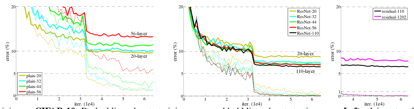
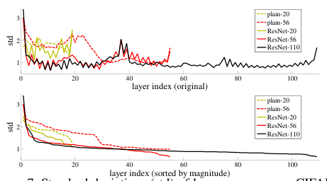

# Page 7 of 12 - Deep Residual Learning for Image Recognition

> Page 7 of the source PDF, verbatim as extracted. Canonical document: [05 - Deep Residual Learning for Image Recognition](../../papers/05-deep-residual-learning-resnet.md)

20

20

20

ResNet-20 ResNet-32 ResNet-44 ResNet-56 ResNet-110 56-layer

residual-110 residual-1202

error (%)

error (%)

error (%)

10

10

10

20-layer

20-layer

110-layer

5

5

5

plain-20 plain-32 plain-44 plain-56

4 5 6 0 1

0 1 2 3 4 5 6 0

0 1 2 3 4 5 6 0

iter. (1e4)

iter. (1e4)

iter. (1e4)

Figure 6. Training on CIFAR-10. Dashed lines denote training error, and bold lines denote testing error. Left: plain networks. The error of plain-110 is higher than 60% and not displayed. Middle: ResNets. Right: ResNets with 110 and 1202 layers.

plain-20 plain-56 ResNet-20 ResNet-56 ResNet-110

training data 07+12 07++12 test data VOC 07 test VOC 12 test VGG-16 73.2 70.4 ResNet-101 76.4 73.8

3

std

2

1

0 20 40 60 80 100

layer index (original)

Table 7. Object detection mAP (%) on the PASCAL VOC 2007/2012 test sets using baseline Faster R-CNN. See also Table 10 and 11 for better results.

plain-20 plain-56 ResNet-20 ResNet-56 ResNet-110

3

std

2

metric mAP@.5 mAP@\[.5, .95\] VGG-16 41.5 21.2 ResNet-101 48.4 27.2

1

0 20 40 60 80 100

layer index (sorted by magnitude)

Figure 7. Standard deviations (std) of layer responses on CIFAR10. The responses are the outputs of each 3×3 layer, after BN and before nonlinearity. Top: the layers are shown in their original order. Bottom: the responses are ranked in descending order.

Table 8. Object detection mAP (%) on the COCO validation set using baseline Faster R-CNN. See also Table 9 for better results.

have similar training error. We argue that this is because of overfitting. The 1202-layer network may be unnecessarily large (19.4M) for this small dataset. Strong regularization such as maxout \[10\] or dropout \[14\] is applied to obtain the best results (\[10, 25, 24, 35\]) on this dataset. In this paper, we use no maxout/dropout and just simply impose regularization via deep and thin architectures by design, without distracting from the focus on the difficulties of optimization. But combining with stronger regularization may improve results, which we will study in the future.

networks such as FitNet \[35\] and Highway \[42\] (Table 6), yet is among the state-of-the-art results (6.43%, Table 6).

Analysis of Layer Responses. Fig. 7 shows the standard deviations (std) of the layer responses. The responses are the outputs of each 3×3 layer, after BN and before other nonlinearity (ReLU/addition). For ResNets, this analysis reveals the response strength of the residual functions. Fig. 7 shows that ResNets have generally smaller responses than their plain counterparts. These results support our basic motivation (Sec.3.1) that the residual functions might be generally closer to zero than the non-residual functions. We also notice that the deeper ResNet has smaller magnitudes of responses, as evidenced by the comparisons among ResNet-20, 56, and 110 in Fig. 7. When there are more layers, an individual layer of ResNets tends to modify the signal less.

## 4.3. Object Detection on PASCAL and MS COCO

Our method has good generalization performance on other recognition tasks. Table 7 and 8 show the object detection baseline results on PASCAL VOC 2007 and 2012 \[5\] and COCO \[26\]. We adopt Faster R-CNN \[32\] as the detection method. Here we are interested in the improvements of replacing VGG-16 \[41\] with ResNet-101. The detection implementation (see appendix) of using both models is the same, so the gains can only be attributed to better networks. Most remarkably, on the challenging COCO dataset we obtain a 6.0% increase in COCO’s standard metric (mAP@\[.5, .95\]), which is a 28% relative improvement. This gain is solely due to the learned representations.

Exploring Over 1000 layers. We explore an aggressively deep model of over 1000 layers. We set n = 200 that leads to a 1202-layer network, which is trained as described above. Our method shows no optimization difficulty, and this 103-layer network is able to achieve training error <0.1% (Fig. 6, right). Its test error is still fairly good (7.93%, Table 6).

Based on deep residual nets, we won the 1st places in several tracks in ILSVRC & COCO 2015 competitions: ImageNet detection, ImageNet localization, COCO detection, and COCO segmentation. The details are in the appendix.

But there are still open problems on such aggressively deep models. The testing result of this 1202-layer network is worse than that of our 110-layer network, although both

8

---

[previous page](page-006.md) · [next page](page-008.md) · [all pages](index.md)
