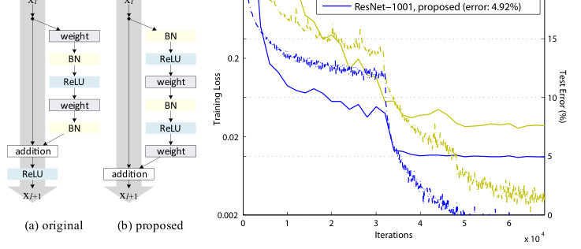

# Page 1 of 15 - Identity Mappings in Deep Residual Networks

> Page 1 of the source PDF, verbatim as extracted. Canonical document: [06 - Identity Mappings in Deep Residual Networks](../../papers/06-identity-mappings-in-deep-residual-networks.md)

ResNet−1001, original (error: 7.61%) ResNet−1001, proposed (error: 4.92%)

xl

xl

weight

BN

15

BN

ReLU

0.2

Test Error (%)

Training Loss

ReLU

weight

10

weight

BN

BN

ReLU

0.02

addition

weight

5

ReLU

addition

xl+1

xl+1

0.002

0

(a) original

(b) proposed

0 1 2 3 4 5 6

Iterations

4

x 10

Figure 1. Left: (a) original Residual Unit in \[1\]; (b) proposed Residual Unit. The grey arrows indicate the easiest paths for the information to propagate, corresponding to the additive term “xl” in Eqn.(4) (forward propagation) and the additive term “1” in Eqn.(5) (backward propagation). Right: training curves on CIFAR-10 of 1001-layer ResNets. Solid lines denote test error (y-axis on the right), and dashed lines denote training loss (y-axis on the left). The proposed unit makes ResNet-1001 easier to train.

achieves the fastest error reduction and lowest training loss among all variants we investigated, whereas skip connections of scaling, gating \[5,6,7\], and 1×1 convolutions all lead to higher training loss and error. These experiments suggest that keeping a “clean” information path (indicated by the grey arrows in Fig. 1, 2, and 4) is helpful for easing optimization.

To construct an identity mapping f(yl) = yl, we view the activation functions (ReLU and BN \[8\]) as “pre-activation” of the weight layers, in contrast to conventional wisdom of “post-activation”. This point of view leads to a new residual unit design, shown in (Fig. 1(b)). Based on this unit, we present competitive results on CIFAR-10/100 with a 1001-layer ResNet, which is much easier to train and generalizes better than the original ResNet in \[1\]. We further report improved results on ImageNet using a 200-layer ResNet, for which the counterpart of \[1\] starts to overfit. These results suggest that there is much room to exploit the dimension of network depth, a key to the success of modern deep learning.

## 2 Analysis of Deep Residual Networks

The ResNets developed in \[1\] are modularized architectures that stack building blocks of the same connecting shape. In this paper we call these blocks “Residual

---

first page · [next page](page-002.md) · [all pages](index.md)
