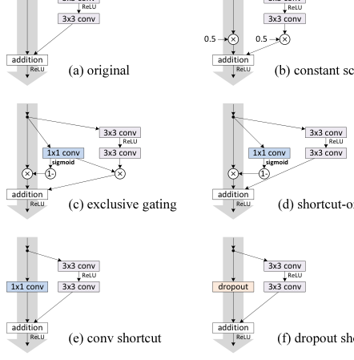

# Page 4 of 15 - Identity Mappings in Deep Residual Networks

> Page 4 of the source PDF, verbatim as extracted. Canonical document: [06 - Identity Mappings in Deep Residual Networks](../../papers/06-identity-mappings-in-deep-residual-networks.md)

3x3 conv

3x3 conv

ReLU

ReLU

3x3 conv

3x3 conv

0.5 0.5

addition

addition

(a) original (b) constant scaling

ReLU

ReLU

3x3 conv

3x3 conv

ReLU

ReLU

1x1 conv sigmoid 1-

3x3 conv

1x1 conv sigmoid 1-

3x3 conv

addition

addition

(d) shortcut-only gating (c) exclusive gating

ReLU

ReLU

3x3 conv

3x3 conv

ReLU

ReLU

1x1 conv

3x3 conv

dropout

3x3 conv

addition

addition

(f) dropout shortcut (e) conv shortcut

ReLU

ReLU

Figure 2. Various types of shortcut connections used in Table 1. The grey arrows indicate the easiest paths for the information to propagate. The shortcut connections in (b-f) are impeded by different components. For simplifying illustrations we do not display the BN layers, which are adopted right after the weight layers for all units here.

## 3.1 Experiments on Skip Connections

We experiment with the 110-layer ResNet as presented in \[1\] on CIFAR-10 \[10\]. This extremely deep ResNet-110 has 54 two-layer Residual Units (consisting of 3×3 convolutional layers) and is challenging for optimization. Our implementation details (see appendix) are the same as \[1\]. Throughout this paper we report the median accuracy of 5 runs for each architecture on CIFAR, reducing the impacts of random variations.

Though our above analysis is driven by identity f, the experiments in this section are all based on f = ReLU as in \[1\]; we address identity f in the next section. Our baseline ResNet-110 has 6.61% error on the test set. The comparisons of other variants (Fig. 2 and Table 1) are summarized as follows:

Constant scaling. We set λ = 0.5 for all shortcuts (Fig. 2(b)). We further study two cases of scaling F: (i) F is not scaled; or (ii) F is scaled by a constant scalar of 1−λ = 0.5, which is similar to the highway gating \[6,7\] but with frozen gates. The former case does not converge well; the latter is able to converge, but the test error (Table 1, 12.35%) is substantially higher than the original ResNet-110. Fig 3(a) shows that the training error is higher than that of the original ResNet-110, suggesting that the optimization has difficulties when the shortcut signal is scaled down.

---

[previous page](page-003.md) · [next page](page-005.md) · [all pages](index.md)
