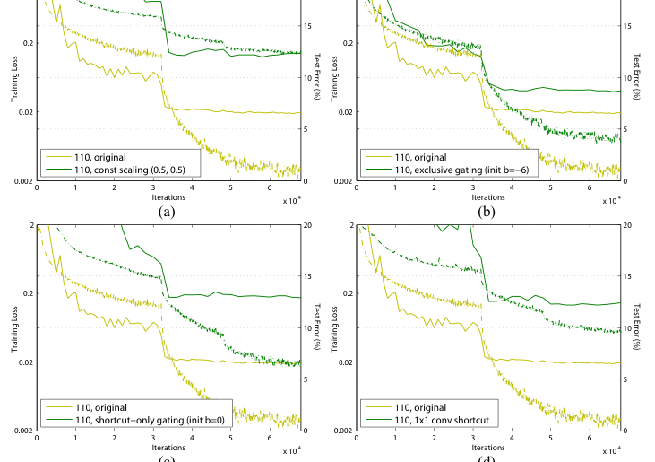

# Page 6 of 15 - Identity Mappings in Deep Residual Networks

> Page 6 of the source PDF, verbatim as extracted. Canonical document: [06 - Identity Mappings in Deep Residual Networks](../../papers/06-identity-mappings-in-deep-residual-networks.md)

15

15

0.2

0.2

Test Error (%)

Test Error (%)

Training Loss

Training Loss

10

10

0.02

0.02

5

5

110, original 110, const scaling (0.5, 0.5)

110, original 110, exclusive gating (init b=−6)

0.002

0

0.002

0

0 1 2 3 4 5 6

0 1 2 3 4 5 6

Iterations

Iterations

4

4

x 10

x 10

(a) (b)

2

20

2

20

15

15

0.2

0.2

Test Error (%)

Test Error (%)

Training Loss

Training Loss

10

10

0.02

0.02

5

5

110, original 110, shortcut−only gating (init b=0)

110, original 110, 1x1 conv shortcut

0.002

0

0.002

0

0 1 2 3 4 5 6

0 1 2 3 4 5 6

Iterations

Iterations

4

4

x 10

x 10

(d) (c)

Figure 3. Training curves on CIFAR-10 of various shortcuts. Solid lines denote test error (y-axis on the right), and dashed lines denote training loss (y-axis on the left).

When the initialized bg is very negatively biased (e.g., −6), the value of 1−g(x) is closer to 1 and the shortcut connection is nearly an identity mapping. Therefore, the result (6.91%, Table 1) is much closer to the ResNet-110 baseline.

1×1 convolutional shortcut. Next we experiment with 1×1 convolutional shortcut connections that replace the identity. This option has been investigated in \[1\] (known as option C) on a 34-layer ResNet (16 Residual Units) and shows good results, suggesting that 1×1 shortcut connections could be useful. But we find that this is not the case when there are many Residual Units. The 110-layer ResNet has a poorer result (12.22%, Table 1) when using 1×1 convolutional shortcuts. Again, the training error becomes higher (Fig 3(d)). When stacking so many Residual Units (54 for ResNet-110), even the shortest path may still impede signal propagation. We witnessed similar phenomena on ImageNet with ResNet-101 when using 1×1 convolutional shortcuts.

Dropout shortcut. Last we experiment with dropout \[11\] (at a ratio of 0.5) which we adopt on the output of the identity shortcut (Fig. 2(f)). The network fails to converge to a good solution. Dropout statistically imposes a scale of λ with an expectation of 0.5 on the shortcut, and similar to constant scaling by 0.5, it impedes signal propagation.

---

[previous page](page-005.md) · [next page](page-007.md) · [all pages](index.md)
