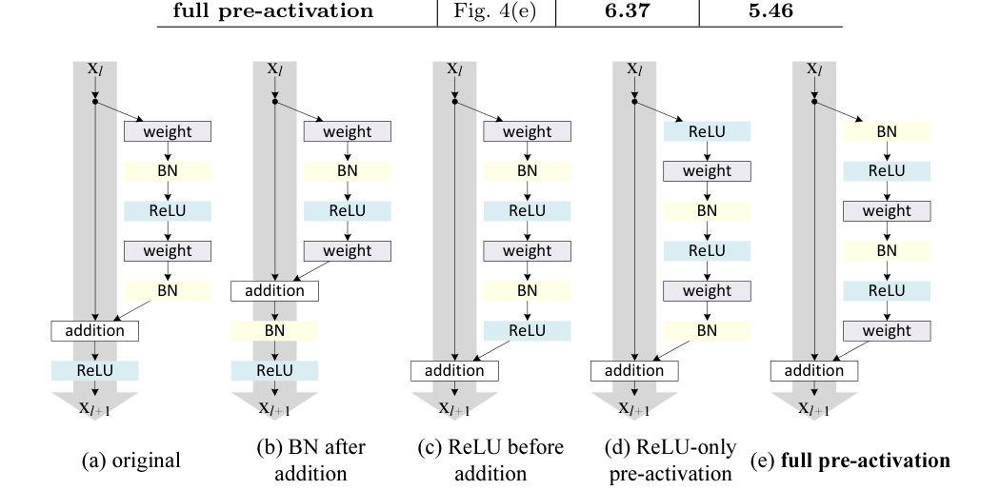

# Page 7 of 15 - Identity Mappings in Deep Residual Networks

> Page 7 of the source PDF, verbatim as extracted. Canonical document: [06 - Identity Mappings in Deep Residual Networks](../../papers/06-identity-mappings-in-deep-residual-networks.md)

Table 2. Classification error (%) on the CIFAR-10 test set using different activation functions.

case Fig. ResNet-110 ResNet-164

original Residual Unit \[1\] Fig. 4(a) 6.61 5.93

BN after addition Fig. 4(b) 8.17 6.50

ReLU before addition Fig. 4(c) 7.84 6.14

ReLU-only pre-activation Fig. 4(d) 6.71 5.91

full pre-activation Fig. 4(e) 6.37 5.46

xl

xl

xl

xl

xl

weight

weight

weight

ReLU

BN

BN

BN

BN

weight

ReLU

ReLU

ReLU

ReLU

BN

weight

weight

weight

weight

ReLU

BN

BN

addition

BN

weight

ReLU

addition

BN

ReLU

BN

weight

ReLU

ReLU

addition

addition

addition

xl+1

xl+1

xl+1

xl+1

xl+1

(a) original (b) BN after

(c) ReLU before

(d) ReLU-only

pre-activation (e) full pre-activation

addition

addition

Figure 4. Various usages of activation in Table 2. All these units consist of the same components — only the orders are different.

## 3.2 Discussions

As indicated by the grey arrows in Fig. 2, the shortcut connections are the most direct paths for the information to propagate. Multiplicative manipulations (scaling, gating, 1×1 convolutions, and dropout) on the shortcuts can hamper information propagation and lead to optimization problems.

It is noteworthy that the gating and 1×1 convolutional shortcuts introduce more parameters, and should have stronger representational abilities than identity shortcuts. In fact, the shortcut-only gating and 1×1 convolution cover the solution space of identity shortcuts (i.e., they could be optimized as identity shortcuts). However, their training error is higher than that of identity shortcuts, indicating that the degradation of these models is caused by optimization issues, instead of representational abilities.

## 4 On the Usage of Activation Functions

Experiments in the above section support the analysis in Eqn.(5) and Eqn.(8), both being derived under the assumption that the after-addition activation f

---

[previous page](page-006.md) · [next page](page-008.md) · [all pages](index.md)
