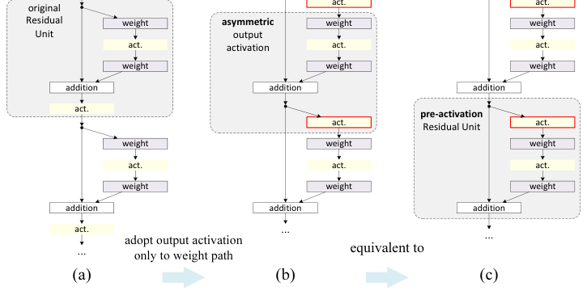

# Page 9 of 15 - Identity Mappings in Deep Residual Networks

> Page 9 of the source PDF, verbatim as extracted. Canonical document: [06 - Identity Mappings in Deep Residual Networks](../../papers/06-identity-mappings-in-deep-residual-networks.md)

act.

act.

original Residual

asymmetric

weight

weight

weight

Unit

output activation

act.

act.

act.

weight

weight

weight

addition

addition

addition

act.

pre-activation

act.

act.

Residual Unit

weight

weight

weight

act.

act.

act.

weight

weight

weight

addition

addition

addition

...

act.

...

adopt output activation

only to weight path equivalent to

...

(a)

(b)

(c)

Figure 5. Using asymmetric after-addition activation is equivalent to constructing a pre-activation Residual Unit.

Table 3. Classification error (%) on the CIFAR-10/100 test set using the original Residual Units and our pre-activation Residual Units.

dataset network baseline unit pre-activation unit

ResNet-110 (1layer skip) 9.90 8.91

ResNet-110 6.61 6.37

CIFAR-10

ResNet-164 5.93 5.46

ResNet-1001 7.61 4.92

CIFAR-100 ResNet-164 25.16 24.33

ResNet-1001 27.82 22.71

The distinction between post-activation/pre-activation is caused by the presence of the element-wise addition. For a plain network that has N layers, there are N −1 activations (BN/ReLU), and it does not matter whether we think of them as post- or pre-activations. But for branched layers merged by addition, the position of activation matters.

We experiment with two such designs: (i) ReLU-only pre-activation (Fig. 4(d)), and (ii) full pre-activation (Fig. 4(e)) where BN and ReLU are both adopted before weight layers. Table 2 shows that the ReLU-only pre-activation performs very similar to the baseline on ResNet-110/164. This ReLU layer is not used in conjunction with a BN layer, and may not enjoy the benefits of BN \[8\].

Somehow surprisingly, when BN and ReLU are both used as pre-activation, the results are improved by healthy margins (Table 2 and Table 3). In Table 3 we report results using various architectures: (i) ResNet-110, (ii) ResNet-164, (iii) a 110-layer ResNet architecture in which each shortcut skips only 1 layer (i.e.,

---

[previous page](page-008.md) · [next page](page-010.md) · [all pages](index.md)
