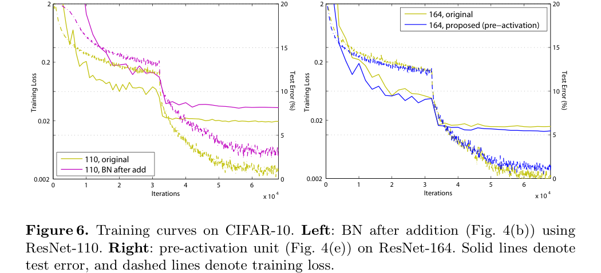

# Page 10 of 15 - Identity Mappings in Deep Residual Networks

> Page 10 of the source PDF, verbatim as extracted. Canonical document: [06 - Identity Mappings in Deep Residual Networks](../../papers/06-identity-mappings-in-deep-residual-networks.md)

15

15

0.2

0.2

Test Error (%)

Test Error (%)

Training Loss

Training Loss

10

10

0.02

0.02

5

5

110, original 110, BN after add

0.002

0

0.002

0

0 1 2 3 4 5 6

0 1 2 3 4 5 6

Iterations

Iterations

4

4

x 10

x 10

Figure 6. Training curves on CIFAR-10. Left: BN after addition (Fig. 4(b)) using ResNet-110. Right: pre-activation unit (Fig. 4(e)) on ResNet-164. Solid lines denote test error, and dashed lines denote training loss.

a Residual Unit has only 1 layer), denoted as “ResNet-110(1layer)”, and (iv) a 1001-layer bottleneck architecture that has 333 Residual Units (111 on each feature map size), denoted as “ResNet-1001”. We also experiment on CIFAR100. Table 3 shows that our “pre-activation” models are consistently better than the baseline counterparts. We analyze these results in the following.

## 4.2 Analysis

We find the impact of pre-activation is twofold. First, the optimization is further eased (comparing with the baseline ResNet) because f is an identity mapping. Second, using BN as pre-activation improves regularization of the models.

Ease of optimization. This effect is particularly obvious when training the 1001-layer ResNet. Fig. 1 shows the curves. Using the original design in \[1\], the training error is reduced very slowly at the beginning of training. For f = ReLU, the signal is impacted if it is negative, and when there are many Residual Units, this effect becomes prominent and Eqn.(3) (so Eqn.(5)) is not a good approximation. On the other hand, when f is an identity mapping, the signal can be propagated directly between any two units. Our 1001-layer network reduces the training loss very quickly (Fig. 1). It also achieves the lowest loss among all models we investigated, suggesting the success of optimization.

We also find that the impact of f = ReLU is not severe when the ResNet has fewer layers (e.g., 164 in Fig. 6(right)). The training curve seems to suffer a little bit at the beginning of training, but goes into a healthy status soon. By monitoring the responses we observe that this is because after some training, the weights are adjusted into a status such that yl in Eqn.(1) is more frequently above zero and f does not truncate it (xl is always non-negative due to the previous ReLU, so yl is below zero only when the magnitude of F is very negative). The truncation, however, is more frequent when there are 1000 layers.

---

[previous page](page-009.md) · [next page](page-011.md) · [all pages](index.md)
