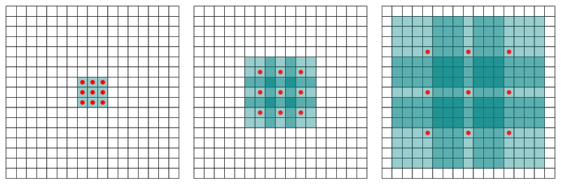

# Page 2 of 13 - Multi-Scale Context Aggregation by Dilated Convolutions

> Page 2 of the source PDF, verbatim as extracted. Canonical document: [07 - Multi-Scale Context Aggregation by Dilated Convolutions](../../papers/07-multi-scale-context-aggregation-dilated-convolutions.md)

(a) (b) (c)

Figure 1: Systematic dilation supports exponential expansion of the receptive field without loss of resolution or coverage. (a) F1 is produced from F0 by a 1-dilated convolution; each element in F1 has a receptive field of 3×3. (b) F2 is produced from F1 by a 2-dilated convolution; each element in F2 has a receptive field of 7×7. (c) F3 is produced from F2 by a 4-dilated convolution; each element in F3 has a receptive field of 15×15. The number of parameters associated with each layer is identical. The receptive field grows exponentially while the number of parameters grows linearly.

easy to see that the size of the receptive field of each element in Fi+1 is (2i+2 −1)×(2i+2 −1). The receptive field is a square of exponentially increasing size. This is illustrated in Figure 1.

## 3 MULTI-SCALE CONTEXT AGGREGATION

The context module is designed to increase the performance of dense prediction architectures by aggregating multi-scale contextual information. The module takes C feature maps as input and produces C feature maps as output. The input and output have the same form, thus the module can be plugged into existing dense prediction architectures.

We begin by describing a basic form of the context module. In this basic form, each layer has C channels. The representation in each layer is the same and could be used to directly obtain a dense per-class prediction, although the feature maps are not normalized and no loss is defined inside the module. Intuitively, the module can increase the accuracy of the feature maps by passing them through multiple layers that expose contextual information.

The basic context module has 7 layers that apply 3×3 convolutions with different dilation factors. The dilations are 1, 1, 2, 4, 8, 16, and 1. Each convolution operates on all layers: strictly speaking, these are 3×3×C convolutions with dilation in the first two dimensions. Each of these convolutions is followed by a pointwise truncation max(·, 0). A final layer performs 1×1×C convolutions and produces the output of the module. The architecture is summarized in Table 1. Note that the frontend module that provides the input to the context network in our experiments produces feature maps at 64×64 resolution. We therefore stop the exponential expansion of the receptive field after layer 6.

Our initial attempts to train the context module failed to yield an improvement in prediction accuracy. Experiments revealed that standard initialization procedures do not readily support the training of the module. Convolutional networks are commonly initialized using samples from random distributions (Glorot & Bengio, 2010; Krizhevsky et al., 2012; Simonyan & Zisserman, 2015). However, we found that random initialization schemes were not effective for the context module. We found an alternative initialization with clear semantics to be much more effective:

kb(t, a) = 1\[t=0\]1\[a=b\], (4)

where a is the index of the input feature map and b is the index of the output map. This is a form of identity initialization, which has recently been advocated for recurrent networks (Le et al., 2015). This initialization sets all filters such that each layer simply passes the input directly to the next. A natural concern is that this initialization could put the network in a mode where backpropagation cannot significantly improve the default behavior of simply passing information through. However, experiments indicate that this is not the case. Backpropagation reliably harvests the contextual information provided by the network to increase the accuracy of the processed maps.

---

[previous page](page-001.md) · [next page](page-003.md) · [all pages](index.md)
