# Page 4 of 13 - Multi-Scale Context Aggregation by Dilated Convolutions

> Page 4 of the source PDF, verbatim as extracted. Canonical document: [07 - Multi-Scale Context Aggregation by Dilated Convolutions](../../papers/07-multi-scale-context-aggregation-dilated-convolutions.md)

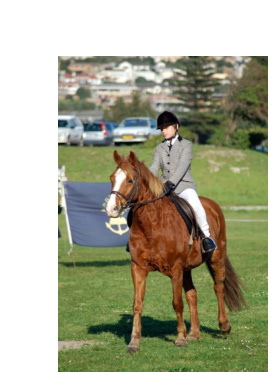

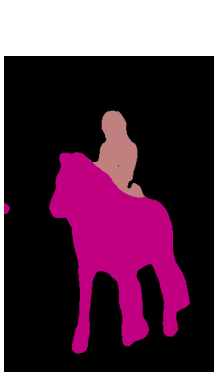

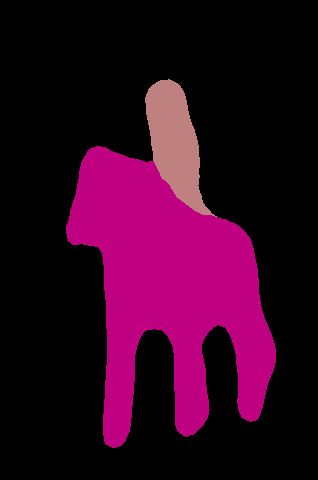

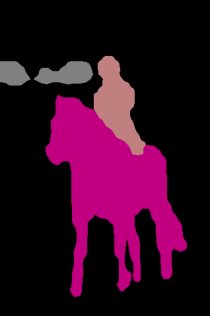

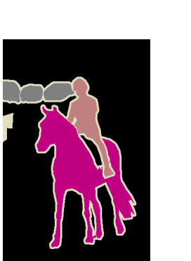

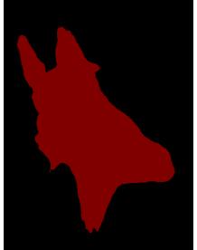

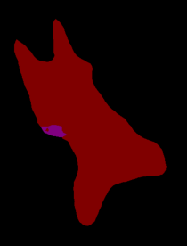

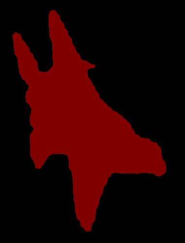

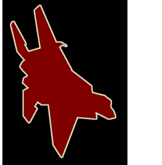

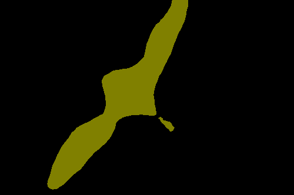

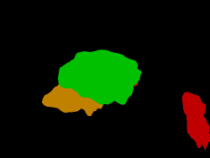

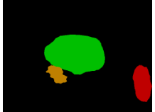

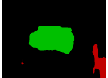

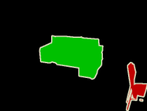

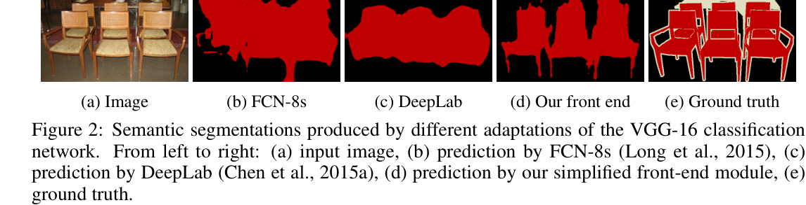

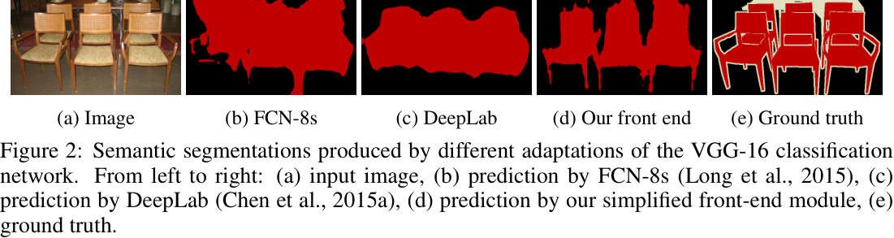

(a) Image

(b) FCN-8s

(c) DeepLab

(d) Our front end

(e) Ground truth

Figure 2: Semantic segmentations produced by different adaptations of the VGG-16 classification network. From left to right: (a) input image, (b) prediction by FCN-8s (Long et al., 2015), (c) prediction by DeepLab (Chen et al., 2015a), (d) prediction by our simplified front-end module, (e) ground truth.

mean IoU

mbike

bottle

person

horse

sheep

chair

table

train

plant

boat

bike

sofa

bird

aero

cow

bus

dog

cat

car

tv

FCN-8s 76.8 34.2 68.9 49.4 60.3 75.3 74.7 77.6 21.4 62.5 46.8 71.8 63.9 76.5 73.9 45.2 72.4 37.4 70.9 55.1 62.2 DeepLab 72 31 71.2 53.7 60.5 77 71.9 73.1 25.2 62.6 49.1 68.7 63.3 73.9 73.6 50.8 72.3 42.1 67.9 52.6 62.1 DeepLab-Msc 74.9 34.1 72.6 52.9 61.0 77.9 73.0 73.7 26.4 62.2 49.3 68.4 64.1 74.0 75.0 51.7 72.7 42.5 67.2 55.7 62.9 Our front end 82.2 37.4 72.7 57.1 62.7 82.8 77.8 78.9 28 70 51.6 73.1 72.8 81.5 79.1 56.6 77.1 49.9 75.3 60.9 67.6

Table 2: Our front-end prediction module is simpler and more accurate than prior models. This table reports accuracy on the VOC-2012 test set.

models trained by the original authors on VOC-2012. Segmentations produced by the different models on images from the VOC-2012 dataset are shown in Figure 2. The accuracy of the models on the VOC-2012 test set is reported in Table 2.

Our front-end prediction module is both simpler and more accurate than the prior models. Specifically, our simplified model outperforms both FCN-8s and the DeepLab network by more than 5 percentage points on the test set. Interestingly, our simplified front-end module outperforms the leaderboard accuracy of DeepLab+CRF on the test set by more than a percentage point (67.6% vs. 66.4%) without using a CRF.

---

[previous page](page-003.md) · [next page](page-005.md) · [all pages](index.md)
