# Page 7 of 13 - Multi-Scale Context Aggregation by Dilated Convolutions

> Page 7 of the source PDF, verbatim as extracted. Canonical document: [07 - Multi-Scale Context Aggregation by Dilated Convolutions](../../papers/07-multi-scale-context-aggregation-dilated-convolutions.md)

mean IoU

mbike

bottle

person

horse

sheep

chair

table

train

plant

boat

bike

sofa

bird

aero

cow

bus

dog

cat

car

tv

DeepLab++ 89.1 38.3 88.1 63.3 69.7 87.1 83.1 85 29.3 76.5 56.5 79.8 77.9 85.8 82.4 57.4 84.3 54.9 80.5 64.1 72.7 DeepLab-MSc++ 89.2 46.7 88.5 63.5 68.4 87.0 81.2 86.3 32.6 80.7 62.4 81.0 81.3 84.3 82.1 56.2 84.6 58.3 76.2 67.2 73.9 CRF-RNN 90.4 55.3 88.7 68.4 69.8 88.3 82.4 85.1 32.6 78.5 64.4 79.6 81.9 86.4 81.8 58.6 82.4 53.5 77.4 70.1 74.7 Front end 86.6 37.3 84.9 62.4 67.3 86.2 81.2 82.1 32.6 77.4 58.3 75.9 81 83.6 82.3 54.2 81.5 50.1 77.5 63 71.3 Context 89.1 39.1 86.8 62.6 68.9 88.2 82.6 87.7 33.8 81.2 59.2 81.8 87.2 83.3 83.6 53.6 84.9 53.7 80.5 62.9 73.5 Context + CRF 91.3 39.9 88.9 64.3 69.8 88.9 82.6 89.7 34.7 82.7 59.5 83 88.4 84.2 85 55.3 86.7 54.4 81.9 63.6 74.7 Context + CRF-RNN 91.7 39.6 87.8 63.1 71.8 89.7 82.9 89.8 37.2 84 63 83.3 89 83.8 85.1 56.8 87.6 56 80.2 64.7 75.3

Table 4: Evaluation on the VOC-2012 test set. ‘DeepLab++’ stands for DeepLab-CRF-COCOLargeFOV and ‘DeepLab-MSc++’ stands for DeepLab-MSc-CRF-LargeFOV-COCO-CrossJoint (Chen et al., 2015a). ‘CRF-RNN’ is the system of Zheng et al. (2015). ‘Context’ refers to the large context module plugged into our front end. The context network yields very high accuracy, ourperforming the DeepLab++ architecture without performing structured prediction. Combining the context network with the CRF-RNN structured prediction module increases the accuracy of the CRF-RNN system.

We believe that the presented work is a step towards dedicated architectures for dense prediction that are not constrained by image classification precursors. As new sources of data become available, future architectures may be trained densely end-to-end, removing the need for pre-training on image classification datasets. This may enable architectural simplification and unification. Specifically, end-to-end dense training may enable a fully dense architecture akin to the presented context network to operate at full resolution throughout, accepting the raw image as input and producing dense label assignments at full resolution as output.

State-of-the-art systems for semantic segmentation leave significant room for future advances. Failure cases of our most accurate configuration are shown in Figure 4. We will release our code and trained models to support progress in this area.

## ACKNOWLEDGEMENTS

We thank Vibhav Vineet for proofreading, help with experiments, and related discussions. We are also grateful to Jonathan Long and the Caffe team for their feedback and for rapidly pulling our implementation into the Caffe library.

## REFERENCES

Badrinarayanan, Vijay, Handa, Ankur, and Cipolla, Roberto. SegNet: A deep convolutional encoder-decoder

architecture for robust semantic pixel-wise labelling. arXiv:1505.07293, 2015.

Brostow, Gabriel J., Fauqueur, Julien, and Cipolla, Roberto. Semantic object classes in video: A high-definition

ground truth database. Pattern Recognition Letters, 30(2), 2009.

Chen, Liang-Chieh, Papandreou, George, Kokkinos, Iasonas, Murphy, Kevin, and Yuille, Alan L. Semantic

image segmentation with deep convolutional nets and fully connected CRFs. In ICLR, 2015a.

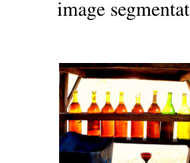

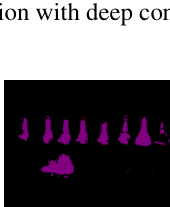

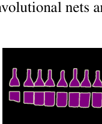

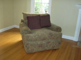

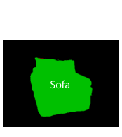

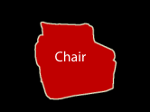

Chair

Sofa

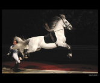

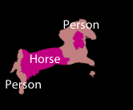

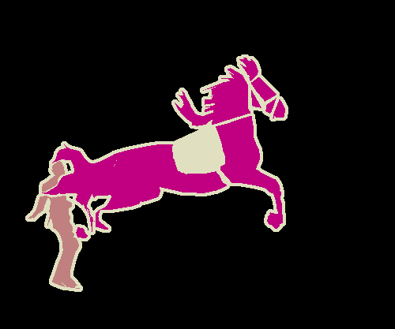

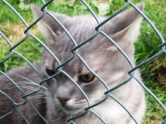

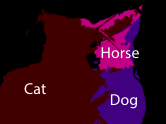

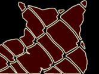

Person

Horse

Horse

Cat Dog

Person

Image

Our result

Ground truth

Image

Our result

Ground truth

Figure 4: Failure cases from the VOC-2012 validation set. The most accurate architecture we trained (Context + CRF-RNN) performs poorly on these images.

---

[previous page](page-006.md) · [next page](page-008.md) · [all pages](index.md)
