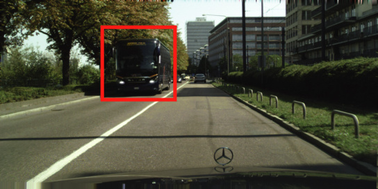
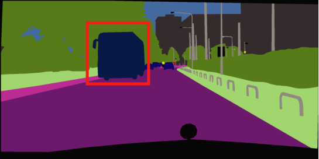

# Page 12 of 13 - Multi-Scale Context Aggregation by Dilated Convolutions

> Page 12 of the source PDF, verbatim as extracted. Canonical document: [07 - Multi-Scale Context Aggregation by Dilated Convolutions](../../papers/07-multi-scale-context-aggregation-dilated-convolutions.md)

(a) Image (b) Ground truth

(c) Front end (d) +Context (e) +Joint (f) Ground truth

Figure 5: Results produced by the Dilation10 model after different training stages. (a) Input image. (b) Ground truth segmentation. (c) Segmentation produced by the model after the first stage of training (front-end only). (d) Segmentation produced after the second stage, which trains the context module. (e) Segmentation produced after the third stage, in which both modules are trained jointly.

Motorcycle

Vegetation

mean IoU

Sidewalk

Building

Terrain

Bicycle

Person

Fence

Truck

Rider

Train

Road

Light

Wall

Pole

Sign

Bus

Car

Sky

Validation set 97.2 79.5 90.4 44.9 52.4 55.1 56.7 69 91 58.7 92.6 75.7 50 92.2 56.2 72.6 54.3 46.2 70.1 68.7 Test set 97.6 79.2 89.9 37.3 47.6 53.2 58.6 65.2 91.8 69.4 93.7 78.9 55 93.3 45.5 53.4 47.7 52.2 66 67.1

Table 7: Per-class and mean class-level IoU achieved by our model (Dilation10) on the Cityscapes dataset.

Flat Nature Object Sky Construction Human Vehicle mean IoU Validation set 98.2 91.4 62.3 92.6 90.7 77.6 91 86.3 Test set 98.3 91.4 60.5 93.7 90.2 79.8 91.8 86.5

Table 8: Per-category and mean category-level IoU on the Cityscapes dataset.

---

[previous page](page-011.md) · [next page](page-013.md) · [all pages](index.md)
