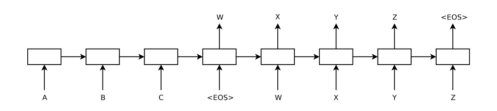

# Page 1 of 9 - Sequence to Sequence Learning with Neural Networks

> Page 1 of the source PDF, verbatim as extracted. Canonical document: [10 - Sequence to Sequence Learning with Neural Networks](../../papers/10-sequence-to-sequence-learning.md)

sequence of words representing the answer. It is therefore clear that a domain-independent method that learns to map sequences to sequences would be useful.

Sequences pose a challenge for DNNs because they require that the dimensionality of the inputs and outputs is known and fixed. In this paper, we show that a straightforward application of the Long Short-Term Memory (LSTM) architecture \[16\] can solve general sequence to sequence problems. The idea is to use one LSTM to read the input sequence, one timestep at a time, to obtain large fixeddimensional vector representation, and then to use another LSTM to extract the output sequence from that vector (fig. 1). The second LSTM is essentially a recurrent neural network language model \[28, 23, 30\] except that it is conditioned on the input sequence. The LSTM’s ability to successfully learn on data with long range temporal dependencies makes it a natural choice for this application due to the considerable time lag between the inputs and their corresponding outputs (fig. 1).

There have been a number of related attempts to address the general sequence to sequence learning problem with neural networks. Our approach is closely related to Kalchbrenner and Blunsom \[18\] who were the first to map the entire input sentence to vector, and is related to Cho et al. \[5\] although the latter was used only for rescoring hypotheses produced by a phrase-based system. Graves \[10\] introduced a novel differentiable attention mechanism that allows neural networks to focus on different parts of their input, and an elegant variant of this idea was successfully applied to machine translation by Bahdanau et al. \[2\]. The Connectionist Sequence Classification is another popular technique for mapping sequences to sequences with neural networks, but it assumes a monotonic alignment between the inputs and the outputs \[11\].

Figure 1: Our model reads an input sentence “ABC” and produces “WXYZ” as the output sentence. The model stops making predictions after outputting the end-of-sentence token. Note that the LSTM reads the input sentence in reverse, because doing so introduces many short term dependencies in the data that make the optimization problem much easier.

The main result of this work is the following. On the WMT’14 English to French translation task, we obtained a BLEU score of 34.81 by directly extracting translations from an ensemble of 5 deep LSTMs (with 384M parameters and 8,000 dimensional state each) using a simple left-to-right beamsearch decoder. This is by far the best result achieved by direct translation with large neural networks. For comparison, the BLEU score of an SMT baseline on this dataset is 33.30 \[29\]. The 34.81 BLEU score was achieved by an LSTM with a vocabulary of 80k words, so the score was penalized whenever the reference translation contained a word not covered by these 80k. This result shows that a relatively unoptimized small-vocabulary neural network architecture which has much room for improvement outperforms a phrase-based SMT system.

Finally, we used the LSTM to rescore the publicly available 1000-best lists of the SMT baseline on the same task \[29\]. By doing so, we obtained a BLEU score of 36.5, which improves the baseline by 3.2 BLEU points and is close to the previous best published result on this task (which is 37.0 \[9\]).

Surprisingly, the LSTM did not suffer on very long sentences, despite the recent experience of other researchers with related architectures \[26\]. We were able to do well on long sentences because we reversed the order of words in the source sentence but not the target sentences in the training and test set. By doing so, we introduced many short term dependencies that made the optimization problem much simpler (see sec. 2 and 3.3). As a result, SGD could learn LSTMs that had no trouble with long sentences. The simple trick of reversing the words in the source sentence is one of the key technical contributions of this work.

A useful property of the LSTM is that it learns to map an input sentence of variable length into a fixed-dimensional vector representation. Given that translations tend to be paraphrases of the source sentences, the translation objective encourages the LSTM to find sentence representations that capture their meaning, as sentences with similar meanings are close to each other while different

---

first page · [next page](page-002.md) · [all pages](index.md)
