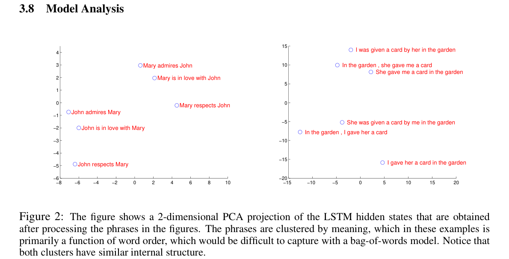

# Page 5 of 9 - Sequence to Sequence Learning with Neural Networks

> Page 5 of the source PDF, verbatim as extracted. Canonical document: [10 - Sequence to Sequence Learning with Neural Networks](../../papers/10-sequence-to-sequence-learning.md)

## Method

## test BLEU score (ntst14)

Bahdanau et al. \[2\]

28.45

Baseline System \[29\]

33.30

Single forward LSTM, beam size 12

26.17

Single reversed LSTM, beam size 12

30.59

Ensemble of 5 reversed LSTMs, beam size 1

33.00

Ensemble of 2 reversed LSTMs, beam size 12

33.27

Ensemble of 5 reversed LSTMs, beam size 2

34.50

Ensemble of 5 reversed LSTMs, beam size 12

## 34.81

Table 1: The performance of the LSTM on WMT’14 English to French test set (ntst14). Note that an ensemble of 5 LSTMs with a beam of size 2 is cheaper than of a single LSTM with a beam of size 12.

## Method

## test BLEU score (ntst14)

Baseline System \[29\]

33.30

Cho et al. \[5\]

34.54

Best WMT’14 result \[9\]

## 37.0

Rescoring the baseline 1000-best with a single forward LSTM

35.61

Rescoring the baseline 1000-best with a single reversed LSTM

35.85

Rescoring the baseline 1000-best with an ensemble of 5 reversed LSTMs

## 36.5

Oracle Rescoring of the Baseline 1000-best lists

∼45

Table 2: Methods that use neural networks together with an SMT system on the WMT’14 English to French test set (ntst14).

task by a sizeable margin, despite its inability to handle out-of-vocabulary words. The LSTM is within 0.5 BLEU points of the best WMT’14 result if it is used to rescore the 1000-best list of the baseline system.

## 3.7 Performance on long sentences

We were surprised to discover that the LSTM did well on long sentences, which is shown quantitatively in figure 3. Table 3 presents several examples of long sentences and their translations.

## 3.8 Model Analysis

15

I was given a card by her in the garden

4

She gave me a card in the garden In the garden , she gave me a card

Mary admires John

3

10

Mary is in love with John

2

5

1

0

0

Mary respects John John admires Mary

−1

−5

She was given a card by me in the garden

John is in love with Mary

−2

In the garden , I gave her a card

−3

−10

−4

−15

I gave her a card in the garden

John respects Mary

−5

−8 −6 −4 −2 0 2 4 6 8 10 −6

−15 −10 −5 0 5 10 15 20 −20

Figure 2: The figure shows a 2-dimensional PCA projection of the LSTM hidden states that are obtained after processing the phrases in the figures. The phrases are clustered by meaning, which in these examples is primarily a function of word order, which would be difficult to capture with a bag-of-words model. Notice that both clusters have similar internal structure.

One of the attractive features of our model is its ability to turn a sequence of words into a vector of fixed dimensionality. Figure 2 visualizes some of the learned representations. The figure clearly shows that the representations are sensitive to the order of words, while being fairly insensitive to the

---

[previous page](page-004.md) · [next page](page-006.md) · [all pages](index.md)
