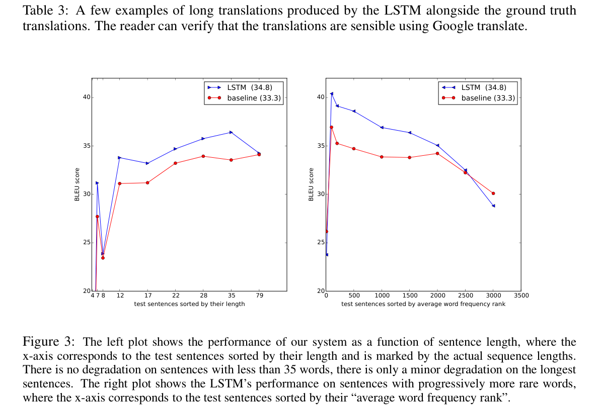

# Page 6 of 9 - Sequence to Sequence Learning with Neural Networks

> Page 6 of the source PDF, verbatim as extracted. Canonical document: [10 - Sequence to Sequence Learning with Neural Networks](../../papers/10-sequence-to-sequence-learning.md)

## Type

## Sentence

Ulrich UNK , membre du conseil d’ administration du constructeur automobile Audi ,

## Our model

affirme qu’ il s’ agit d’ une pratique courante depuis des ann´ees pour que les t´el´ephones

portables puissent ˆetre collect´es avant les r´eunions du conseil d’ administration afin qu’ ils

ne soient pas utilis´es comme appareils d’ ´ecoute \`a distance .

Ulrich Hackenberg , membre du conseil d’ administration du constructeur automobile Audi ,

## Truth

d´eclare que la collecte des t´el´ephones portables avant les r´eunions du conseil , afin qu’ ils

ne puissent pas ˆetre utilis´es comme appareils d’ ´ecoute \`a distance , est une pratique courante

depuis des ann´ees .

“ Les t´el´ephones cellulaires , qui sont vraiment une question , non seulement parce qu’ ils

## Our model

pourraient potentiellement causer des interf´erences avec les appareils de navigation , mais

nous savons , selon la FCC , qu’ ils pourraient interf´erer avec les tours de t´el´ephone cellulaire

lorsqu’ ils sont dans l’ air ” , dit UNK .

“ Les t´el´ephones portables sont v´eritablement un probl\`eme , non seulement parce qu’ ils

## Truth

pourraient ´eventuellement cr´eer des interf´erences avec les instruments de navigation , mais

parce que nous savons , d’ apr\`es la FCC , qu’ ils pourraient perturber les antennes-relais de

t´el´ephonie mobile s’ ils sont utilis´es \`a bord ” , a d´eclar´e Rosenker .

Avec la cr´emation , il y a un “ sentiment de violence contre le corps d’ un ˆetre cher ” ,

## Our model

qui sera “ r´eduit \`a une pile de cendres ” en tr\`es peu de temps au lieu d’ un processus de

d´ecomposition “ qui accompagnera les ´etapes du deuil ” .

Il y a , avec la cr´emation , “ une violence faite au corps aim´e ” ,

## Truth

qui va ˆetre “ r´eduit \`a un tas de cendres ” en tr\`es peu de temps , et non apr\`es un processus de

d´ecomposition , qui “ accompagnerait les phases du deuil ” .

Table 3: A few examples of long translations produced by the LSTM alongside the ground truth translations. The reader can verify that the translations are sensible using Google translate.

LSTM (34.8) baseline (33.3)

LSTM (34.8) baseline (33.3)

40

40

35

35

BLEU score

BLEU score

30

30

25

25

20

20

4 7 8 12 17 22 28 35 79 test sentences sorted by their length

0 500 1000 1500 2000 2500 3000 3500 test sentences sorted by average word frequency rank

Figure 3: The left plot shows the performance of our system as a function of sentence length, where the x-axis corresponds to the test sentences sorted by their length and is marked by the actual sequence lengths. There is no degradation on sentences with less than 35 words, there is only a minor degradation on the longest sentences. The right plot shows the LSTM’s performance on sentences with progressively more rare words, where the x-axis corresponds to the test sentences sorted by their “average word frequency rank”.

replacement of an active voice with a passive voice. The two-dimensional projections are obtained using PCA.

## 4 Related work

There is a large body of work on applications of neural networks to machine translation. So far, the simplest and most effective way of applying an RNN-Language Model (RNNLM) \[23\] or a

---

[previous page](page-005.md) · [next page](page-007.md) · [all pages](index.md)
