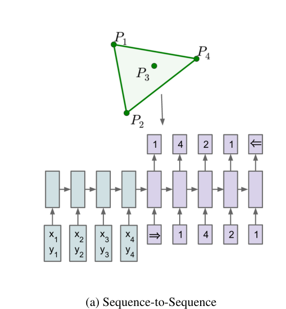
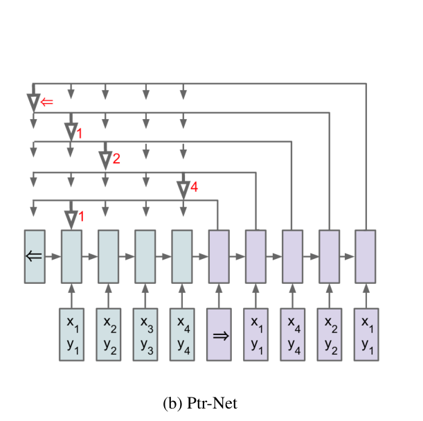

# Page 1 of 9 - Pointer Networks

> Page 1 of the source PDF, verbatim as extracted. Canonical document: [12 - Pointer Networks](../../papers/12-pointer-networks.md)

(b) Ptr-Net

(a) Sequence-to-Sequence

Figure 1: (a) Sequence-to-Sequence - An RNN (blue) processes the input sequence to create a code vector that is used to generate the output sequence (purple) using the probability chain rule and another RNN. The output dimensionality is fixed by the dimensionality of the problem and it is the same during training and inference \[1\]. (b) Ptr-Net - An encoding RNN converts the input sequence to a code (blue) that is fed to the generating network (purple). At each step, the generating network produces a vector that modulates a content-based attention mechanism over inputs (\[5, 2\]). The output of the attention mechanism is a softmax distribution with dictionary size equal to the length of the input.

ion (i.e., when we only have examples of inputs and desired outputs). The proposed approach is depicted in Figure 1.

The main contributions of our work are as follows:

• We propose a new architecture, that we call Pointer Net, which is simple and effective. It deals with the fundamental problem of representing variable length dictionaries by using a softmax probability distribution as a “pointer”. • We apply the Pointer Net model to three distinct non-trivial algorithmic problems involving geometry. We show that the learned model generalizes to test problems with more points than the training problems. • Our Pointer Net model learns a competitive small scale (n ≤50) TSP approximate solver. Our results demonstrate that a purely data driven approach can learn approximate solutions to problems that are computationally intractable.

## 2 Models

We review the sequence-to-sequence \[1\] and input-attention models \[5\] that are the baselines for this work in Sections 2.1 and 2.2. We then describe our model - Ptr-Net in Section 2.3.

## 2.1 Sequence-to-Sequence Model

Given a training pair, (P, CP), the sequence-to-sequence model computes the conditional probability p(CP|P; θ) using a parametric model (an RNN with parameters θ) to estimate the terms of the probability chain rule (also see Figure 1), i.e.

m(P) Y

p(CP|P; θ) =

pθ(Ci|C1, . . . , Ci−1, P; θ). (1)

i=1

---

first page · [next page](page-002.md) · [all pages](index.md)
