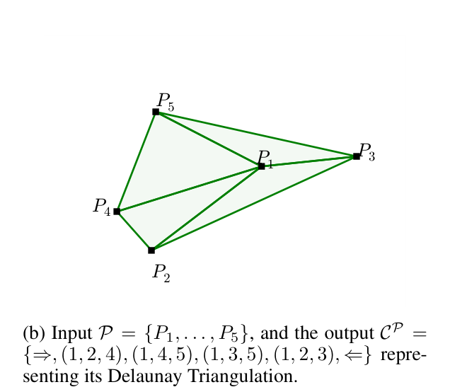
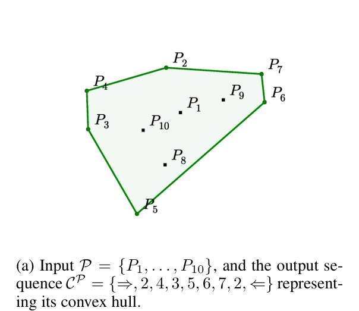

# Page 4 of 9 - Pointer Networks

> Page 4 of the source PDF, verbatim as extracted. Canonical document: [12 - Pointer Networks](../../papers/12-pointer-networks.md)

P5

P3

P1

P4

P2

(b) Input P = {P1, . . . , P5}, and the output CP = {⇒, (1, 2, 4), (1, 4, 5), (1, 3, 5), (1, 2, 3), ⇐} representing its Delaunay Triangulation.

(a) Input P = {P1, . . . , P10}, and the output sequence CP = {⇒, 2, 4, 3, 5, 6, 7, 2, ⇐} representing its convex hull.

Figure 2: Input/output representation for (a) convex hull and (b) Delaunay triangulation. The tokens ⇒and ⇐represent beginning and end of sequence, respectively.

## 3.2 Delaunay Triangulation

A Delaunay triangulation for a set P of points in a plane is a triangulation such that each circumcircle of every triangle is empty, that is, there is no point from P in its interior. Exact O(n log n) solutions are available \[16\], where n is the number of points in P.

In this example, the outputs CP = {C1, . . . , Cm(P)} are the corresponding sequences representing the triangulation of the point set P . Each Ci is a triple of integers from 1 to n corresponding to the position of triangle vertices in P or the beginning/end of sequence tokens. See Figure 2 (b).

We note that any permutation of the sequence CP represents the same triangulation for P, additionally each triangle representation Ci of three integers can also be permuted. Without loss of generality, and similarly to what we did for convex hulls at training time, we order the triangles Ci by their incenter coordinates (lexicographic order) and choose the increasing triangle representation2. Without ordering, the models learned were not as good, and finding a better ordering that the Ptr-Net could better exploit is part of future work.

## 3.3 Travelling Salesman Problem (TSP)

TSP arises in many areas of theoretical computer science and is an important algorithm used for microchip design or DNA sequencing. In our work we focused on the planar symmetric TSP: given a list of cities, we wish to find the shortest possible route that visits each city exactly once and returns to the starting point. Additionally, we assume the distance between two cities is the same in each opposite direction. This is an NP-hard problem which allows us to test the capabilities and limitations of our model.

The input/output pairs (P, CP) have a similar format as in the Convex Hull problem described in Section 3.1. P will be the cartesian coordinates representing the cities, which are chosen randomly in the \[0, 1\] × \[0, 1\] square. CP = {C1, . . . , Cn} will be a permutation of integers from 1 to n representing the optimal path (or tour). For consistency, in the training dataset, we always start in the first city without loss of generality.

To generate exact data, we implemented the Held-Karp algorithm \[17\] which finds the optimal solution in O(2nn2) (we used it up to n = 20). For larger n, producing exact solutions is extremely costly, therefore we also considered algorithms that produce approximated solutions: A1 \[18\] and A2 \[19\], which are both O(n2), and A3 \[20\] which implements the O(n3) Christofides algorithm. The latter algorithm is guaranteed to find a solution within a factor of 1.5 from the optimal length. Table 2 shows how they performed in our test sets.

2We choose Ci = (1, 2, 4) instead of (2,4,1) or any other permutation.

---

[previous page](page-003.md) · [next page](page-005.md) · [all pages](index.md)
