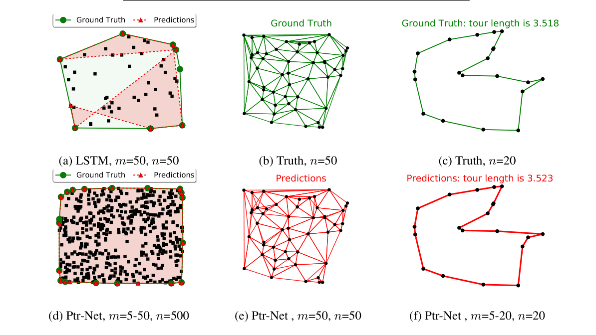

# Page 6 of 9 - Pointer Networks

> Page 6 of the source PDF, verbatim as extracted. Canonical document: [12 - Pointer Networks](../../papers/12-pointer-networks.md)

Table 1: Comparison between LSTM, LSTM with attention, and our Ptr-Net model on the convex hull problem. Note that the baselines must be trained on the same n that they are tested on.

METHOD TRAINED n n ACCURACY AREA

LSTM \[1\] 50 50 1.9% FAIL +ATTENTION \[5\] 50 50 38.9% 99.7% PTR-NET 50 50 72.6% 99.9% LSTM \[1\] 5 5 87.7% 99.6% PTR-NET 5-50 5 92.0% 99.6% LSTM \[1\] 10 10 29.9% FAIL PTR-NET 5-50 10 87.0% 99.8% PTR-NET 5-50 50 69.6% 99.9% PTR-NET 5-50 100 50.3% 99.9% PTR-NET 5-50 200 22.1% 99.9% PTR-NET 5-50 500 1.3% 99.2%

Ground Truth Predictions

Ground Truth

Ground Truth: tour length is 3.518

(a) LSTM, m=50, n=50

(b) Truth, n=50

(c) Truth, n=20

Ground Truth Predictions

Predictions

Predictions: tour length is 3.523

(d) Ptr-Net, m=5-50, n=500

(e) Ptr-Net , m=50, n=50

(f) Ptr-Net , m=5-20, n=20

Figure 3: Examples of our model on Convex hulls (left), Delaunay (center) and TSP (right), trained on m points, and tested on n points. A failure of the LSTM sequence-to-sequence model for Convex hulls is shown in (a). Note that the baselines cannot be applied to a different length from training. Using the Ptr-Net model for n = 5, we obtained an accuracy of 80.7% and triangle coverage of 93.0%. For n = 10, the accuracy was 22.6% and the triangle coverage 81.3%. For n = 50, we did not produce any precisely correct triangulation, but obtained 52.8% triangle coverage. See the middle column of Figure 3 for an example for n = 50.

## 4.4 Travelling Salesman Problem

We considered the planar symmetric travelling salesman problem (TSP), which is NP-hard as the third problem. Similarly to finding convex hulls, it also has sequential outputs. Given that the PtrNet implements an O(n2) algorithm, it was unclear if it would have enough capacity to learn a useful algorithm solely from data.

As discussed in Section 3.3, it is feasible to generate exact solutions for relatively small values of n to be used as training data. For larger n, due to the importance of TSP, good and efficient algorithms providing reasonable approximate solutions exist. We used three different algorithms in our experiments – A1, A2, and A3 (see Section 3.3 for references).

Table 2 shows all of our results on TSP. The number reported is the length of the proposed tour. Unlike the convex hull and Delaunay triangulation cases, where the decoder was unconstrained, in

---

[previous page](page-005.md) · [next page](page-007.md) · [all pages](index.md)
