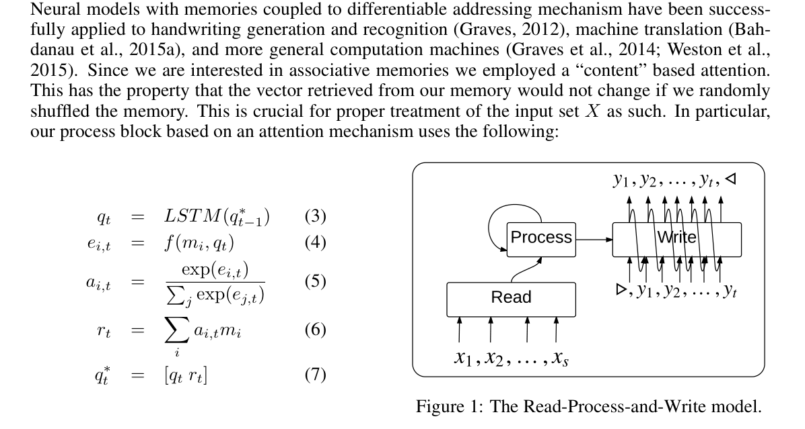

# Page 3 of 11 - Order Matters: Sequence to Sequence for Sets

> Page 3 of the source PDF, verbatim as extracted. Canonical document: [13 - Order Matters: Sequence to Sequence for Sets](../../papers/13-order-matters-sequence-to-sequence-for-sets.md)

All these empirical findings point to the same story: often for optimization purposes, the order in which input data is shown to the model has an impact on the learning performance.

Note that we can define an ordering which is independent of the input sequence or set X (e.g., always reversing the words in a translation task), but also an ordering which is input dependent (e.g., sorting the input points in the convex hull case). This distinction also applies in the discussion about output sequences and sets in Section 5.1.

Recent approaches which pushed the seq2seq paradigm further by adding memory and computation to these models allowed us to define a model which makes no assumptions about input ordering, whilst preserving the right properties which we just discussed: a memory that increases with the size of the set, and which is order invariant. In the next sections, we explain such a modification, which could also be seen as a special case of a Memory Network (Weston et al., 2015) or Neural Turing Machine (Graves et al., 2014) – with a computation flow as depicted in Figure 1.

4.2 ATTENTION MECHANISMS

Neural models with memories coupled to differentiable addressing mechanism have been successfully applied to handwriting generation and recognition (Graves, 2012), machine translation (Bahdanau et al., 2015a), and more general computation machines (Graves et al., 2014; Weston et al., 2015). Since we are interested in associative memories we employed a “content” based attention. This has the property that the vector retrieved from our memory would not change if we randomly shuffled the memory. This is crucial for proper treatment of the input set X as such. In particular, our process block based on an attention mechanism uses the following:

qt = LSTM(q∗

t−1) (3) ei,t = f(mi, qt) (4)

Process Write

ai,t = exp(ei,t) P

j exp(ej,t) (5)

Read

X

rt =

ai,tmi (6)

i

q∗

t = \[qt rt\] (7)

Figure 1: The Read-Process-and-Write model.

where i indexes through each memory vector mi (typically equal to the cardinality of X), qt is a query vector which allows us to read rt from the memories, f is a function that computes a single scalar from mi and qt (e.g., a dot product), and LSTM is an LSTM which computes a recurrent state but which takes no inputs. q∗

t is the state which this LSTM evolves, and is formed by concatenating the query qt with the resulting attention readout rt. t is the index which indicates how many “processing steps” are being carried to compute the state to be fed to the decoder. Note that permuting mi and mi′ has no effect on the read vector rt.

4.3 READ, PROCESS, WRITE

Our model, which naturally handles input sets, has three components (the exact equations and implementation will be released in an appendix prior to publication):

• A reading block, which simply embeds each element xi ∈X using a small neural network onto a memory vector mi (the same neural network is used for all i).

• A process block, which is an LSTM without inputs or outputs performing T steps of computation over the memories mi. This LSTM keeps updating its state by reading mi repeatedly using the attention mechanism described in the previous section. At the end of this block, its hidden state q∗

T is an embedding which is permutation invariant to the inputs. See eqs. (3)-(7) for more details.

---

[previous page](page-002.md) · [next page](page-004.md) · [all pages](index.md)
