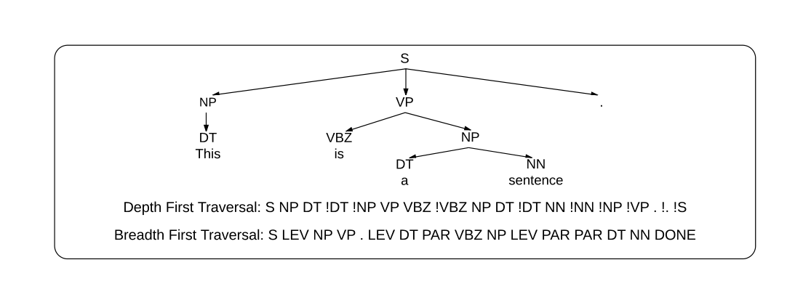

# Page 6 of 11 - Order Matters: Sequence to Sequence for Sets

> Page 6 of the source PDF, verbatim as extracted. Canonical document: [13 - Order Matters: Sequence to Sequence for Sets](../../papers/13-order-matters-sequence-to-sequence-for-sets.md)

S

. VP

NP

NP

DT This

VBZ

is

NN sentence

DT

a

Depth First Traversal: S NP DT !DT !NP VP VBZ !VBZ NP DT !DT NN !NN !NP !VP . !. !S

Breadth First Traversal: S LEV NP VP . LEV DT PAR VBZ NP LEV PAR PAR DT NN DONE

Figure 2: Depth first and breadth first linearizations of a parse tree which shows our different setups for output ordering in the parsing task.

5.1.3 COMBINATORIAL PROBLEMS

Unlike in the previous two examples, a problem that more commonly comes up as we try to represent non-sequential data (like tours, triangulations, etc., discussed by (Vinyals et al., 2015a)), is the fact that there may exist a large equivalence class of solutions.

Take, as an example, outputting the indices for the sorted inputs of a set of random numbers, X. Indeed, this is a deterministic function. We can choose to output these indices in some order (e.g., increasing, decreasing, or using any arbitrary fixed permutation), or treat them as a set (a tuple of argsort indices with corresponding ranking). As a result, there are n! possible outputs for a given X, all of which are perfectly valid. If our training set is generated with any of these permutations picked uniformly at random, our mapping (when perfectly trained) will have to place equal probability on n! output configurations for the same input X. Thus, this formulation is much less statistically efficient.

In previous work (Vinyals et al., 2015a), it was found that restricting as much as possible the equivalence class for the outputs was always better. For instance, to output a tour (i.e. a sequence of cities one has to visit for the traveling salesman problem), we started from the lower indexed city (i.e., the first city that we input), and followed a counter-clockwise ordering. Similarly, to output a set of triangles (which triangulate the set of input points), we sorted them in lexicographical order and moved left to right. In all cases, improvements of 5% absolute accuracy or more were observed.

Failing to restrict the output equivalence class generally implies much slower convergence (and, thus, requires much more training data). For instance, for sorting, if considering the outputs as sets which we output in any of the possible n! orderings, convergence for n as small as 5 never reached the same performance.

5.1.4 GRAPHICAL MODELS

Let us consider the joint probability of a set of T random variables P(y1, y2, . . . , yT ). Having no prior on how these random variables interact with each other, one way to model their joint probability is to use the chain rule as follows:

T Y

P(yt|y1, y2, . . . , yt−1) (8)

P(y1, y2, . . . , yT ) =

t=1

and model this using an RNN, similar to RNN language models.

While for sentences the natural order of words gives a good clue of how to order the random variables in the model, for other kind of data it might be harder to decide on it. Furthermore, in theory, the order should not matter, because of Bayes rule which lets us reorder all the conditional probabilities as needed. In practice however, it might be that one order is easier to model than another, as we have shown in this paper.

The purpose of this experiment is to demonstrate this using a controlled toy experiment. We generated star-like graphical models over random variables where one variable (the head) follows an unconditional distribution, while the others follow a conditional distribution based on the value of

---

[previous page](page-005.md) · [next page](page-007.md) · [all pages](index.md)
