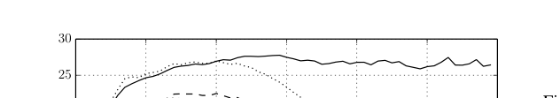

# Page 4 of 15 - Neural Machine Translation by Jointly Learning to Align and Translate

> Page 4 of the source PDF, verbatim as extracted. Canonical document: [14 - Neural Machine Translation by Jointly Learning to Align and Translate](../../papers/14-neural-machine-translation-jointly-learning-to-align-and-translate.md)

30

25

Figure 2: The BLEU scores of the generated translations on the test set with respect to the lengths of the sentences. The results are on the full test set which includes sentences having unknown words to the models.

20

BLEU score

15

RNNsearch-50 RNNsearch-30 RNNenc-50 RNNenc-30

10

5

0

0 10 20 30 40 50 60 Sentence length

2012 and news-test-2013 to make a development (validation) set, and evaluate the models on the test set (news-test-2014) from WMT ’14, which consists of 3003 sentences not present in the training data.

After a usual tokenization6, we use a shortlist of 30,000 most frequent words in each language to train our models. Any word not included in the shortlist is mapped to a special token (\[UNK\]). We do not apply any other special preprocessing, such as lowercasing or stemming, to the data.

4.2 MODELS

We train two types of models. The first one is an RNN Encoder–Decoder (RNNencdec, Cho et al., 2014a), and the other is the proposed model, to which we refer as RNNsearch. We train each model twice: first with the sentences of length up to 30 words (RNNencdec-30, RNNsearch-30) and then with the sentences of length up to 50 word (RNNencdec-50, RNNsearch-50).

The encoder and decoder of the RNNencdec have 1000 hidden units each.7 The encoder of the RNNsearch consists of forward and backward recurrent neural networks (RNN) each having 1000 hidden units. Its decoder has 1000 hidden units. In both cases, we use a multilayer network with a single maxout (Goodfellow et al., 2013) hidden layer to compute the conditional probability of each target word (Pascanu et al., 2014).

We use a minibatch stochastic gradient descent (SGD) algorithm together with Adadelta (Zeiler, 2012) to train each model. Each SGD update direction is computed using a minibatch of 80 sentences. We trained each model for approximately 5 days.

Once a model is trained, we use a beam search to find a translation that approximately maximizes the conditional probability (see, e.g., Graves, 2012; Boulanger-Lewandowski et al., 2013). Sutskever et al. (2014) used this approach to generate translations from their neural machine translation model.

For more details on the architectures of the models and training procedure used in the experiments, see Appendices A and B.

## 5 RESULTS

5.1 QUANTITATIVE RESULTS

In Table 1, we list the translation performances measured in BLEU score. It is clear from the table that in all the cases, the proposed RNNsearch outperforms the conventional RNNencdec. More importantly, the performance of the RNNsearch is as high as that of the conventional phrase-based translation system (Moses), when only the sentences consisting of known words are considered. This is a significant achievement, considering that Moses uses a separate monolingual corpus (418M words) in addition to the parallel corpora we used to train the RNNsearch and RNNencdec.

6 We used the tokenization script from the open-source machine translation package, Moses. 7 In this paper, by a ’hidden unit’, we always mean the gated hidden unit (see Appendix A.1.1).

---

[previous page](page-003.md) · [next page](page-005.md) · [all pages](index.md)
