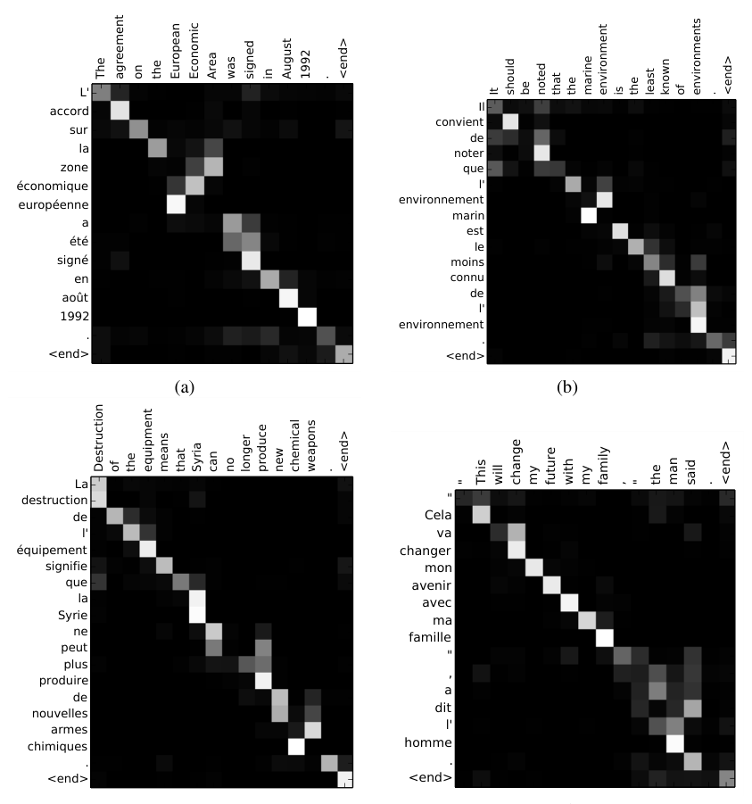

# Page 5 of 15 - Neural Machine Translation by Jointly Learning to Align and Translate

> Page 5 of the source PDF, verbatim as extracted. Canonical document: [14 - Neural Machine Translation by Jointly Learning to Align and Translate](../../papers/14-neural-machine-translation-jointly-learning-to-align-and-translate.md)

agreement

environments

Economic

European

environment

<end>

August

signed

1992

Area

<end>

marine

was

The

should

known

the

noted

on

least

in

that

.

the

the

be

of

L'

is

It

.

Il convient

accord

sur

de noter

la

zone

que

l' environnement

économique

européenne

marin

a

est

été

le moins connu

signé

en

de

août

l' environnement

1992

.

. <end>

<end>

(a) (b)

Destruction

equipment

chemical

weapons

produce

<end>

means

longer

change

<end>

Syria

family

future

new

that

can

the

man

no

with

said

This

of

will

the

my

my

.

La destruction

"

"

,

.

" Cela

de

va changer

l' équipement

signifie

mon avenir

que

la Syrie

avec

ma famille

ne peut

"

plus produire

, a dit

de nouvelles

l' homme

armes chimiques

. <end>

. <end>

(c) (d)

Figure 3: Four sample alignments found by RNNsearch-50. The x-axis and y-axis of each plot correspond to the words in the source sentence (English) and the generated translation (French), respectively. Each pixel shows the weight αij of the annotation of the j-th source word for the i-th target word (see Eq. (6)), in grayscale (0: black, 1: white). (a) an arbitrary sentence. (b–d) three randomly selected samples among the sentences without any unknown words and of length between 10 and 20 words from the test set.

One of the motivations behind the proposed approach was the use of a fixed-length context vector in the basic encoder–decoder approach. We conjectured that this limitation may make the basic encoder–decoder approach to underperform with long sentences. In Fig. 2, we see that the performance of RNNencdec dramatically drops as the length of the sentences increases. On the other hand, both RNNsearch-30 and RNNsearch-50 are more robust to the length of the sentences. RNNsearch50, especially, shows no performance deterioration even with sentences of length 50 or more. This superiority of the proposed model over the basic encoder–decoder is further confirmed by the fact that the RNNsearch-30 even outperforms RNNencdec-50 (see Table 1).

---

[previous page](page-004.md) · [next page](page-006.md) · [all pages](index.md)
