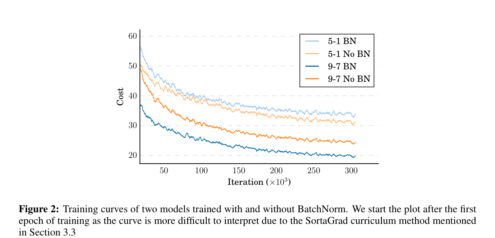

# Page 6 of 28 - Deep Speech 2: End-to-End Speech Recognition in English and Mandarin

> Page 6 of the source PDF, verbatim as extracted. Canonical document: [15 - Deep Speech 2: End-to-End Speech Recognition in English and Mandarin](../../papers/15-deep-speech-2.md)

60

5-1 BN 5-1 No BN 9-7 BN 9-7 No BN

50

Cost

40

30

20

50 100 150 200 250 300 Iteration (⇥103)

Figure 2: Training curves of two models trained with and without BatchNorm. We start the plot after the first epoch of training as the curve is more difficult to interpret due to the SortaGrad curriculum method mentioned in Section 3.3

Train Dev

Baseline BatchNorm Baseline BatchNorm

Not Sorted 10.71 8.04 11.96 9.78 Sorted 8.76 7.68 10.83 9.52

Table 2: Comparison of WER on a training and development set with and without SortaGrad, and with and without batch normalization.

number of parameters and still see strong performance gains. We would expect to see even larger improvements from depth if we held constant the number of activations per layer and added layers. We also find that BatchNorm harms generalization error for the shallowest network just as it converges slower for shallower networks.

The BatchNorm approach works well in training, but is difficult to implement for a deployed ASR system, since it is often necessary to evaluate a single utterance in deployment rather than a batch. We find that normalizing each neuron to its mean and variance over just the sequence degrades performance. Instead, we store a running average of the mean and variance for the neuron collected during training, and use these for evaluation in deployment \[63\]. Using this technique, we can evaluate a single utterance at a time with better results than evaluating with a large batch.

## 3.3 SortaGrad

Training on examples of varying length pose some algorithmic challenges. One possible solution is truncating backpropagation through time \[68\], so that all examples have the same sequence length during training \[52\]. However, this can inhibit the ability to learn longer term dependencies. Other works have found that presenting examples in order of difficulty can accelerate online learning \[6, 70\]. A common theme in many sequence learning problems including machine translation and speech recognition is that longer examples tend to be more challenging \[11\].

The CTC cost function that we use implicitly depends on the length of the utterance,

T Y

X

L(x, y; θ) = −log

pctc(ℓt|x; θ). (9)

t

ℓ∈Align(x,y)

where Align(x, y) is the set of all possible alignments of the characters of the transcription y to frames of input x under the CTC operator. In equation 9, the inner term is a product over time-steps of the sequence, which shrinks with the length of the sequence since pctc(ℓt|x; θ) < 1. This motivates a curriculum learning strategy we title SortaGrad. SortaGrad uses the length of the utterance as a heuristic for difficulty, since long utterances have higher cost than short utterances.

---

[previous page](page-005.md) · [next page](page-007.md) · [all pages](index.md)
