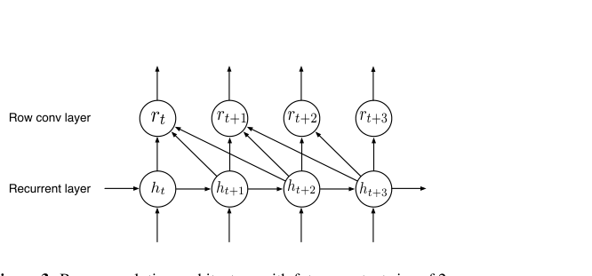

# Page 10 of 28 - Deep Speech 2: End-to-End Speech Recognition in English and Mandarin

> Page 10 of the source PDF, verbatim as extracted. Canonical document: [15 - Deep Speech 2: End-to-End Speech Recognition in English and Mandarin](../../papers/15-deep-speech-2.md)

## rt+3 rt+2 rt+1 rt

Row conv layer

ht ht+1 ht+2 ht+3

Recurrent layer

Figure 3: Row convolution architecture with future context size of 2

τ+1 X

rt,i =

Wi,jht+j−1,i, for 1 ≤i ≤d. (11)

j=1

Since the convolution-like operation in Eq. 11 is row oriented for both W and ht:t+τ, we call this layer row convolution.

We place the row convolution layer above all recurrent layers. This has two advantages. First, this allows us to stream all computation below the row convolution layer on a finer granularity given little future context is needed. Second, this results in better CER compared to the best bidirectional model for Mandarin. We conjecture that the recurrent layers have learned good feature representations, so the row convolution layer simply gathers the appropriate information to feed to the classifier. Results for a unidirectional Mandarin speech system with row convolution and a comparison to a bidirectional model are given in Section 7 on deployment.

## 3.8 Language Model

We train our RNN Models over millions of unique utterances, which enables the network to learn a powerful implicit language model. Our best models are quite adept at spelling, without any external language constraints. Further, in our development datasets we find many cases where our models can implicitly disambiguate homophones—for example, “he expects the Japanese agent to sell it for two hundred seventy five thousand dollars”. Nevertheless, the labeled training data is small compared to the size of unlabeled text corpora that are available. Thus we find that WER improves when we supplement our system with a language model trained from external text.

We use an n-gram language model since they scale well to large amounts of unlabeled text \[26\]. For English, our language model is a Kneser-Ney smoothed 5-gram model with pruning that is trained using the KenLM toolkit \[28\] on cleaned text from the Common Crawl Repository3. The vocabulary is the most frequently used 400,000 words from 250 million lines of text, which produces a language model with about 850 million n-grams. For Mandarin, the language model is a KneserNey smoothed character level 5-gram model with pruning that is trained on an internal text corpus of 8 billion lines of text. This produces a language model with about 2 billion n-grams.

During inference we search for the transcription y that maximizes Q(y) shown in Equation 12. This is a linear combination of log probabilities from the CTC trained network and language model, along with a word insertion term \[26\].

Q(y) = log(pctc(y|x)) + α log(plm(y)) + β word\_count(y) (12)

The weight α controls the relative contributions of the language model and the CTC network. The weight β encourages more words in the transcription. These parameters are tuned on a development set. We use a beam search to find the optimal transcription \[27\].

3http://commoncrawl.org

---

[previous page](page-009.md) · [next page](page-011.md) · [all pages](index.md)
