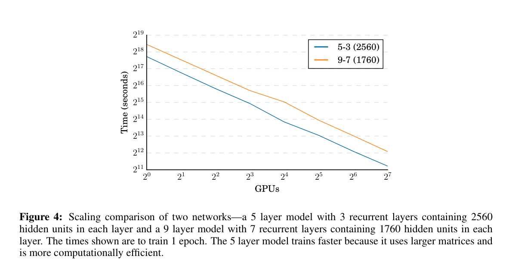

# Page 12 of 28 - Deep Speech 2: End-to-End Speech Recognition in English and Mandarin

> Page 12 of the source PDF, verbatim as extracted. Canonical document: [15 - Deep Speech 2: End-to-End Speech Recognition in English and Mandarin](../../papers/15-deep-speech-2.md)

binds one process to each GPU. These processes then exchange gradient matrices during the backpropagation by using all-reduce, which exchanges a matrix between multiple processes and sums the result so that at the end, each process has a copy of the sum of all matrices from all processes.

We find synchronous SGD useful because it is reproducible and deterministic. We have found that the appearance of non-determinism in our system often signals a serious bug, and so having reproducibility as a goal has greatly facilitates debugging. In contrast, asynchronous methods such as asynchronous SGD with parameter servers as found in Dean et al. \[18\] typically do not provide reproducibility and are therefore more difficult to debug. Synchronous SGD is simple to understand and implement. It scales well as we add multiple nodes to the training process.

211 212 213 214 215 216 217 218 219

5-3 (2560) 9-7 (1760)

Time (seconds)

20 21 22 23 24 25 26 27

GPUs

Figure 4: Scaling comparison of two networks—a 5 layer model with 3 recurrent layers containing 2560 hidden units in each layer and a 9 layer model with 7 recurrent layers containing 1760 hidden units in each layer. The times shown are to train 1 epoch. The 5 layer model trains faster because it uses larger matrices and is more computationally efficient.

Figure 4 shows that time taken to train one epoch halves as we double the number of GPUs that we train on, thus achieving near-linear weak scaling. We keep the minibatch per GPU constant at 64 during this experiment, effectively doubling the minibatch as we double the number of GPUs. Although we have the ability to scale to large minibatches, we typically use either 8 or 16 GPUs during training with a minibatch of 512 or 1024, in order to converge to the best result.

Since all-reduce is critical to the scalability of our training, we wrote our own implementation of the ring algorithm \[48, 65\] for higher performance and better stability. Our implementation avoids extraneous copies between CPU and GPU, and is fundamental to our scalability. We configure OpenMPI with the smcuda transport that can send and receive buffers residing in the memory of two different GPUs by using GPUDirect. When two GPUs are in the same PCI root complex, this avoids any unnecessary copies to CPU memory. This also takes advantage of tree-structured interconnects by running multiple segments of the ring concurrently between neighboring devices. We built our implementation using MPI send and receive, along with CUDA kernels for the elementwise operations.

Table 7 compares the performance of our all-reduce implementation with that provided by OpenMPI version 1.8.5. We report the time spent in all-reduce for a full training run that ran for one epoch on our English dataset using a 5 layer, 3 recurrent layer architecture with 2560 hidden units for all layers. In this table, we use a minibatch of 64 per GPU, expanding the algorithmic minibatch as we scale to more GPUs. We see that our implementation is considerably faster than OpenMPI’s when the communication is within a node (8 GPUs or less). As we increase the number of GPUs and increase the amount of inter-node communication, the gap shrinks, although our implementation is still 2-4X faster.

All of our training runs use either 8 or 16 GPUs, and in this regime, our all-reduce implementation results in 2.5× faster training for the full training run, compared to using OpenMPI directly. Optimizing all-reduce has thus resulted in important productivity benefits for our experiments, and has made our simple synchronous SGD approach scalable.

---

[previous page](page-011.md) · [next page](page-013.md) · [all pages](index.md)
