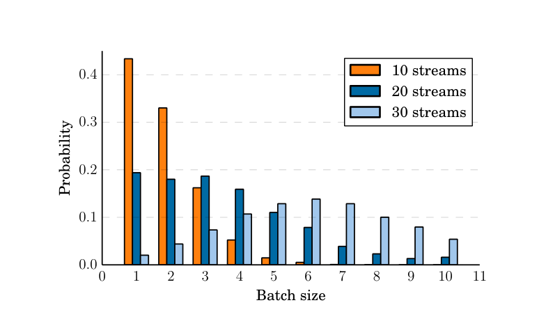
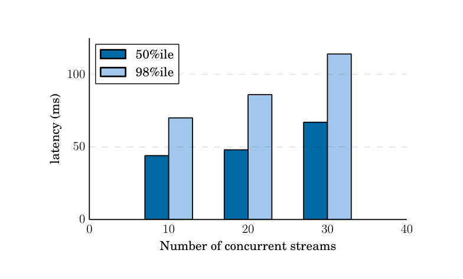

# Page 20 of 28 - Deep Speech 2: End-to-End Speech Recognition in English and Mandarin

> Page 20 of the source PDF, verbatim as extracted. Canonical document: [15 - Deep Speech 2: End-to-End Speech Recognition in English and Mandarin](../../papers/15-deep-speech-2.md)

10 streams 20 streams 30 streams

0.4

0.3

Probability

0.2

0.1

0.0

0 1 2 3 4 5 6 7 8 9 10 11 Batch size

Figure 5: Probability that a request is processed in a batch of given size

sample relies on sequential matrix vector multiplications, which are bandwidth bound and difficult to parallelize.

To overcome these issues, we built a batching scheduler called Batch Dispatch that assembles streams of data from user requests into batches before performing forward propagation on these batches. In this case, there is a tradeoff between increased batch size, and consequently improved efficiency, and increased latency. The more we buffer user requests to assemble a large batch, the longer users must wait for their results. This places constraints on the amount of batching we can perform.

We use an eager batching scheme that processes each batch as soon as the previous batch is completed, regardless of how much work is ready by that point. This scheduling algorithm has proved to be the best at reducing end-user latency, despite the fact that it is less efficient computationally, since it does not attempt to maximize batch size.

Figure 5 shows the probability that a request is processed in a batch of given size for our production system running on a single NVIDIA Quadro K1200 GPU, with 10-30 concurrent user requests. As expected, batching works best when the server is heavily loaded: as load increases, the distribution shifts to favor processing requests in larger batches. However, even with a light load of only 10 concurrent user requests, our system performs more than half the work in batches with at least 2 samples.

50%ile 98%ile

100

latency (ms)

50

0

0 10 20 30 40 Number of concurrent streams

Figure 6: Median and 98 percentile latencies as a function of server load

We see in Figure 6, that our system achieves a median latency of 44 ms, and a 98 percentile latency of 70 ms when loaded with 10 concurrent streams. As the load increases on the server, the batching scheduler shifts work to more efficient batches, which keeps latency low. This shows that Batch Dispatch makes it possible to deploy these large models at high throughput and low latency.

---

[previous page](page-019.md) · [next page](page-021.md) · [all pages](index.md)
