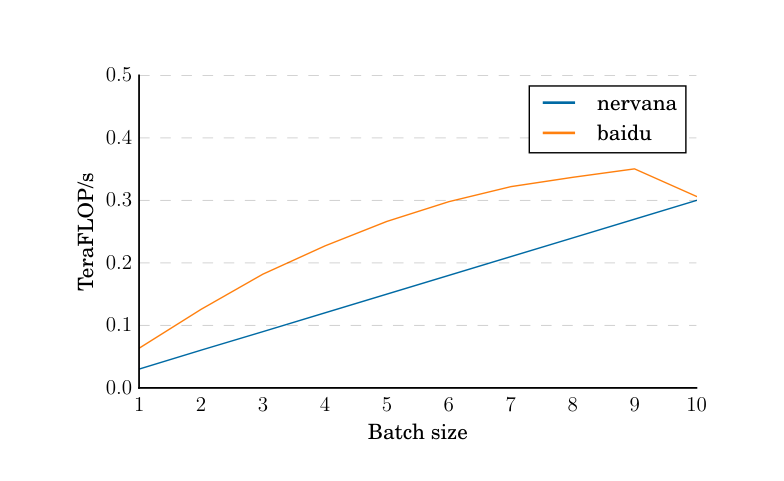

# Page 21 of 28 - Deep Speech 2: End-to-End Speech Recognition in English and Mandarin

> Page 21 of the source PDF, verbatim as extracted. Canonical document: [15 - Deep Speech 2: End-to-End Speech Recognition in English and Mandarin](../../papers/15-deep-speech-2.md)

0.5

nervana baidu

0.4

TeraFLOP/s

0.3

0.2

0.1

0.0

1 2 3 4 5 6 7 8 9 10 Batch size

Figure 7: Comparison of kernels that compute Ax = b where A is a matrix with dimension 2560 × 2560, and x is a matrix with dimension 2560 × Batch size, where Batch size ∈\[1, 10\]. All matrices are in half-precision format.

## 7.2 Deployment Optimized Matrix Multiply Kernels

We have found that deploying our models using half-precision (16-bit) floating-point arithmetic does not measurably change recognition accuracy. Because deployment does not require any updates to the network weights, it is far less sensitive to numerical precision than training. Using half-precision arithmetic saves memory space and bandwidth, which is especially useful for deployment, since RNN evaluation is dominated by the cost of caching and streaming the weight matrices.

As seen in Section 7.1, the batch size during deployment is much smaller than in training. We found that standard BLAS libraries are inefficient at this batch size. To overcome this, we wrote our own half-precision matrix-matrix multiply kernel. For 10 simultaneous streams over 90 percent of batches are for N ≤4, a regime where the matrix multiply will be bandwidth bound. We store the A matrix transposed to maximize bandwidth by using the widest possible vector loads while avoiding transposition after loading. Each warp computes four rows of output for all N output columns. Note that for N ≤4 the B matrix fits entirely in the L1 cache. This scheme achieves 90 percent of peak bandwidth for N ≤4 but starts to lose efficiency for larger N as the B matrix stops fitting into the L1 cache. Nonetheless, it continues to provide improved performance over existing libraries up to N = 10.

Figure 7 shows that our deployment kernel sustains a higher computational throughput than those from Nervana Systems \[44\] on the K1200 GPU, across the entire range of batch sizes that we use in deployment. Both our kernels and the Nervana kernels are significantly faster than NVIDIA CUBLAS version 7.0, more details are found here \[20\].

## 7.3 Beam Search

Performing the beam search involves repeated lookups in the n-gram language model, most of which translate to uncached reads from memory. The direct implementation of beam search means that each time-step dispatches one lookup per character for each beam. In Mandarin, this results in over 1M lookups per 40ms stride of speech data, which is too slow for deployment. To deal with this problem, we use a heuristic to further prune the beam search. Rather than considering all characters as viable additions to the beam, we only consider the fewest number of characters whose cumulative probability is at least p. In practice, we have found that p = 0.99 works well. Additionally, we limit ourselves to no more than 40 characters. This speeds up the Mandarin language model lookup time by a factor of 150x, and has a negligible effect on the CER (0.1-0.3% relative).

## 7.4 Results

We can deploy our system at low latency and high throughput without sacrificing much accuracy. On a held-out set of 2000 utterances, our research system achieves 5.81 character error rate whereas the deployed system achieves 6.10 character error rate. This is only a 5% relative degradation for

---

[previous page](page-020.md) · [next page](page-022.md) · [all pages](index.md)
