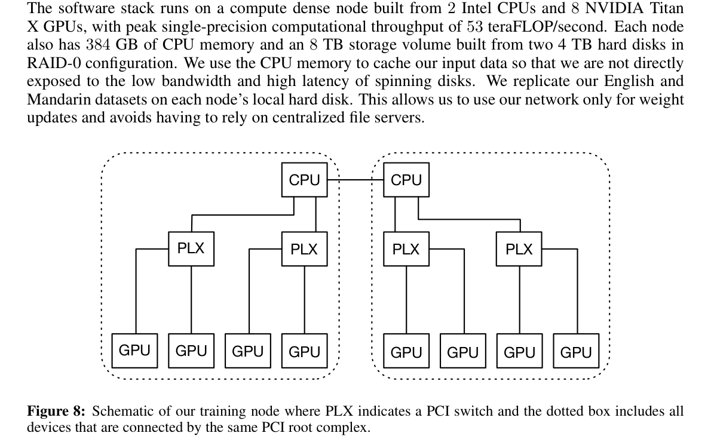

# Page 25 of 28 - Deep Speech 2: End-to-End Speech Recognition in English and Mandarin

> Page 25 of the source PDF, verbatim as extracted. Canonical document: [15 - Deep Speech 2: End-to-End Speech Recognition in English and Mandarin](../../papers/15-deep-speech-2.md)

\[61\] I. Sutskever, J. Martens, G. Dahl, and G. Hinton. On the importance of momentum and initialization in

deep learning. In 30th International Conference on Machine Learning, 2013.

\[62\] I. Sutskever, O. Vinyals, and Q. V. Le. Sequence to sequence learning with neural networks. 2014.

http://arxiv.org/abs/1409.3215.

\[63\] C. Szegedy and S. Ioffe. Batch normalization: Accelerating deep network training by reducing internal

covariate shift. abs/1502.03167, 2015. http://arxiv.org/abs/1502.03167.

\[64\] C. Szegedy, W. Liu, Y. Jia, P. Sermanet, S. Reed, D. Anguelov, D. Erhan, V. Vanhoucke, and A. Rabi-

novich. Going deeper with convolutions. 2014.

\[65\] R. Thakur and R. Rabenseifner. Optimization of collective communication operations in mpich. Interna-

tional Journal of High Performance Computing Applications, 19:49–66, 2005.

\[66\] K. Vesely, A. Ghoshal, L. Burget, and D. Povey. Sequence-discriminative training of deep neural net-

works. In Interspeech, 2013.

\[67\] A. Waibel, T. Hanazawa, G. Hinton, K. Shikano, and K. Lang. Phoneme recognition using time-delay

neural networks,â ˘A˙I acoustics speech and signal processing. IEEE Transactions on Acoustics, Speech and Signal Processing, 37(3):328–339, 1989.

\[68\] R. Williams and J. Peng. An efficient gradient-based algorithm for online training of recurrent network

trajectories. Neural computation, 2:490–501, 1990.

\[69\] T. Yoshioka, N. Ito, M. Delcroix, A. Ogawa, K. Kinoshita, M. F. C. Yu, W. J. Fabian, M. Espi, T. Higuchi,

S. Araki, and T. Nakatani. The ntt chime-3 system: Advances in speech enhancement and recognition for mobile multi-microphone devices. In IEEE ASRU, 2015.

\[70\] W. Zaremba and I. Sutskever. Learning to execute. abs/1410.4615, 2014. http://arxiv.org/abs/1410.4615.

## A Scalability improvements

In this section, we discuss some of our scalability improvements in more detail.

## A.1 Node and cluster architecture

The software stack runs on a compute dense node built from 2 Intel CPUs and 8 NVIDIA Titan X GPUs, with peak single-precision computational throughput of 53 teraFLOP/second. Each node also has 384 GB of CPU memory and an 8 TB storage volume built from two 4 TB hard disks in RAID-0 configuration. We use the CPU memory to cache our input data so that we are not directly exposed to the low bandwidth and high latency of spinning disks. We replicate our English and Mandarin datasets on each node’s local hard disk. This allows us to use our network only for weight updates and avoids having to rely on centralized file servers.

CPU CPU

PLX PLX PLX

PLX

GPU GPU GPU GPU GPU GPU GPU GPU

Figure 8: Schematic of our training node where PLX indicates a PCI switch and the dotted box includes all devices that are connected by the same PCI root complex.

Figure 8 shows a schematic diagram of one our nodes, where all devices connected by the same PCI root complex are encapsulated in a dotted box. We have tried to maximize the number of GPUs within the root complex for faster communication between GPUs using GPUDirect. This allows us to use an efficient communication mechanism to transfer gradient matrices between GPUs.

---

[previous page](page-024.md) · [next page](page-026.md) · [all pages](index.md)
