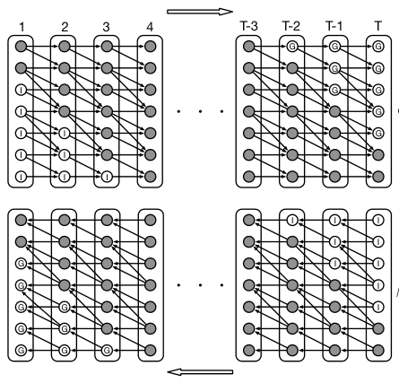

# Page 27 of 28 - Deep Speech 2: End-to-End Speech Recognition in English and Mandarin

> Page 27 of the source PDF, verbatim as extracted. Canonical document: [15 - Deep Speech 2: End-to-End Speech Recognition in English and Mandarin](../../papers/15-deep-speech-2.md)

1 2 3 4 T-3 T-2 T-1 T

B

G

G G

C

G

G

B

I

G

G

## ↵

I A

G

B

I

I

G

T

I I

B

I I I

B

I

I I

C

I

I

B

G

I

I

## β

G A

I

B

G

G

I

T

G G

B

G G G

Figure 9: Forward and backward pass for GPU implementation of CTC. Gray circles contain valid values, circle with I contain −∞and circle with G contain garbage values that are finite. B stand for the blank character that the CTC algorithm adds to the input utterance label. Column labels on top show different time-steps going from 1 to T.

values, with each character as key, we must deal with data dependencies due to repeated characters in an utterance label. For languages with small character sets like English, this happens with high probability. Even if there are no repeated characters, the CTC algorithm adds L + 1 blank characters to the utterance label. We solve this problem by performing a key-value sort, where the keys are the characters in the utterance label, and the values are the indices of each character in the utterance. After sorting, all occurrences of a given character are arranged in contiguous segments. We only need to do the sort once for each utterance. The indices generated by the sort are then used to sequentially sum up the gradients for each character. This sum is done once per column and in parallel over all characters in the utterance. Amortizing the cost of key-value sort over T columns is a key insight that makes the gradient calculation fast.

Our GPU implementation uses fast shared memory and registers to achieve high performance when performing this task. Both forward and backward kernels store the α matrix in shared memory. Since shared memory is a limited resource, it is not possible to store the entire β matrix. However, as we go backward in time, we only need to keep one column of the β matrix as we compute the gradient, adding element-wise the column of the β matrix with the corresponding column of the α matrix. Due to on-chip memory space constraints, we read the output of the softmax function directly from off-chip global memory.

Due to inaccuracies in floating-point arithmetic, especially in transcendental functions, our GPU and CPU implementation are not bit-wise identical. This is not an impediment in practice, since both implementations train models equally well when coupled with the technique of sorting utterances by length mentioned in Section 3.3.

---

[previous page](page-026.md) · [next page](page-028.md) · [all pages](index.md)
