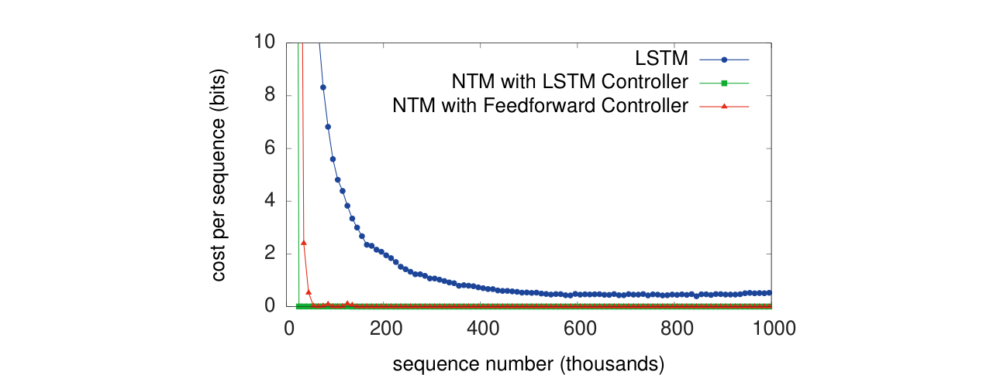

# Page 10 of 26 - Neural Turing Machines

> Page 10 of the source PDF, verbatim as extracted. Canonical document: [16 - Neural Turing Machines](../../papers/16-neural-turing-machines.md)

10

LSTM NTM with LSTM Controller NTM with Feedforward Controller

cost per sequence (bits)

8

6

4

2

0

0 200 400 600 800 1000

sequence number (thousands)

Figure 3: Copy Learning Curves.

rather than quantitative, difference in the way the two models solve the problem.

We also studied the ability of the networks to generalise to longer sequences than seen during training (that they can generalise to novel vectors is clear from the training error). Figures 4 and 5 demonstrate that the behaviour of LSTM and NTM in this regime is radically different. NTM continues to copy as the length increases2, while LSTM rapidly degrades beyond length 20.

The preceding analysis suggests that NTM, unlike LSTM, has learned some form of copy algorithm. To determine what this algorithm is, we examined the interaction between the controller and the memory (Figure 6). We believe that the sequence of operations performed by the network can be summarised by the following pseudocode:

initialise: move head to start location while input delimiter not seen do

receive input vector write input to head location increment head location by 1 end while return head to start location while true do

read output vector from head location emit output increment head location by 1 end while

This is essentially how a human programmer would perform the same task in a low-

2The limiting factor was the size of the memory (128 locations), after which the cyclical shifts wrapped around and previous writes were overwritten.

11

---

[previous page](page-009.md) · [next page](page-011.md) · [all pages](index.md)
