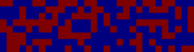
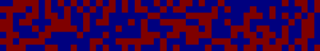
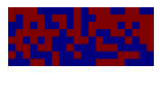
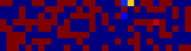
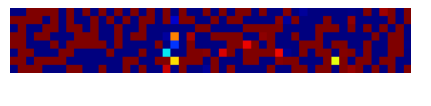
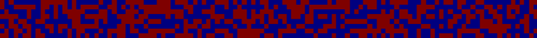
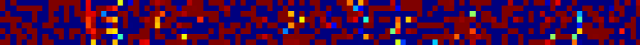

# Page 11 of 26 - Neural Turing Machines

> Page 11 of the source PDF, verbatim as extracted. Canonical document: [16 - Neural Turing Machines](../../papers/16-neural-turing-machines.md)

Figure 4: NTM Generalisation on the Copy Task. The four pairs of plots in the top row depict network outputs and corresponding copy targets for test sequences of length 10, 20, 30, and 50, respectively. The plots in the bottom row are for a length 120 sequence. The network was only trained on sequences of up to length 20. The first four sequences are reproduced with high confidence and very few mistakes. The longest one has a few more local errors and one global error: at the point indicated by the red arrow at the bottom, a single vector is duplicated, pushing all subsequent vectors one step back. Despite being subjectively close to a correct copy, this leads to a high loss.

level programming language. In terms of data structures, we could say that NTM has learned how to create and iterate through arrays. Note that the algorithm combines both content-based addressing (to jump to start of the sequence) and location-based addressing (to move along the sequence). Also note that the iteration would not generalise to long sequences without the ability to use relative shifts from the previous read and write weightings (Equation 7), and that without the focus-sharpening mechanism (Equation 9) the weightings would probably lose precision over time.

## 4.2 Repeat Copy

The repeat copy task extends copy by requiring the network to output the copied sequence a specified number of times and then emit an end-of-sequence marker. The main motivation was to see if the NTM could learn a simple nested function. Ideally, we would like it to be able to execute a “for loop” containing any subroutine it has already learned.

The network receives random-length sequences of random binary vectors, followed by a scalar value indicating the desired number of copies, which appears on a separate input channel. To emit the end marker at the correct time the network must be both able to interpret the extra input and keep count of the number of copies it has performed so far. As with the copy task, no inputs are provided to the network after the initial sequence and repeat number. The networks were trained to reproduce sequences of size eight random binary vectors, where both the sequence length and the number of repetitions were chosen randomly from one to ten. The input representing the repeat number was normalised to have mean zero and variance one.

12

---

[previous page](page-010.md) · [next page](page-012.md) · [all pages](index.md)
