# Page 12 of 26 - Neural Turing Machines

> Page 12 of the source PDF, verbatim as extracted. Canonical document: [16 - Neural Turing Machines](../../papers/16-neural-turing-machines.md)

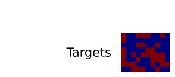

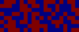

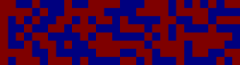

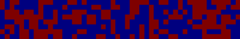

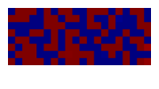

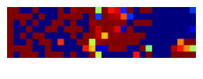

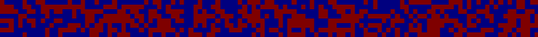

Figure 5: LSTM Generalisation on the Copy Task. The plots show inputs and outputs for the same sequence lengths as Figure 4. Like NTM, LSTM learns to reproduce sequences of up to length 20 almost perfectly. However it clearly fails to generalise to longer sequences. Also note that the length of the accurate prefix decreases as the sequence length increases, suggesting that the network has trouble retaining information for long periods.

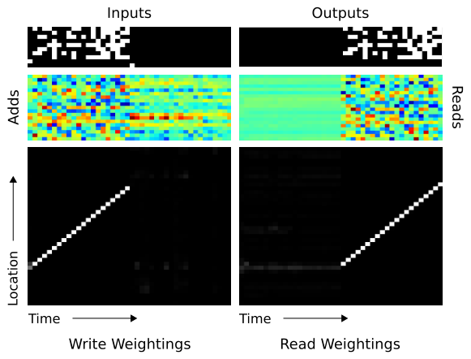

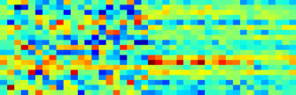

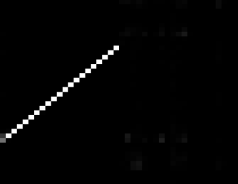

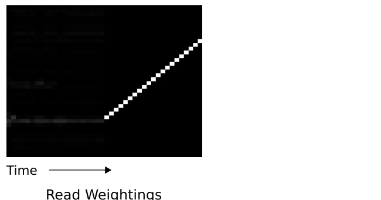

Figure 6: NTM Memory Use During the Copy Task. The plots in the left column depict the inputs to the network (top), the vectors added to memory (middle) and the corresponding write weightings (bottom) during a single test sequence for the copy task. The plots on the right show the outputs from the network (top), the vectors read from memory (middle) and the read weightings (bottom). Only a subset of memory locations are shown. Notice the sharp focus of all the weightings on a single location in memory (black is weight zero, white is weight one). Also note the translation of the focal point over time, reflects the network’s use of iterative shifts for location-based addressing, as described in Section 3.3.2. Lastly, observe that the read locations exactly match the write locations, and the read vectors match the add vectors. This suggests that the network writes each input vector in turn to a specific memory location during the input phase, then reads from the same location sequence during the output phase.

13

---

[previous page](page-011.md) · [next page](page-013.md) · [all pages](index.md)
